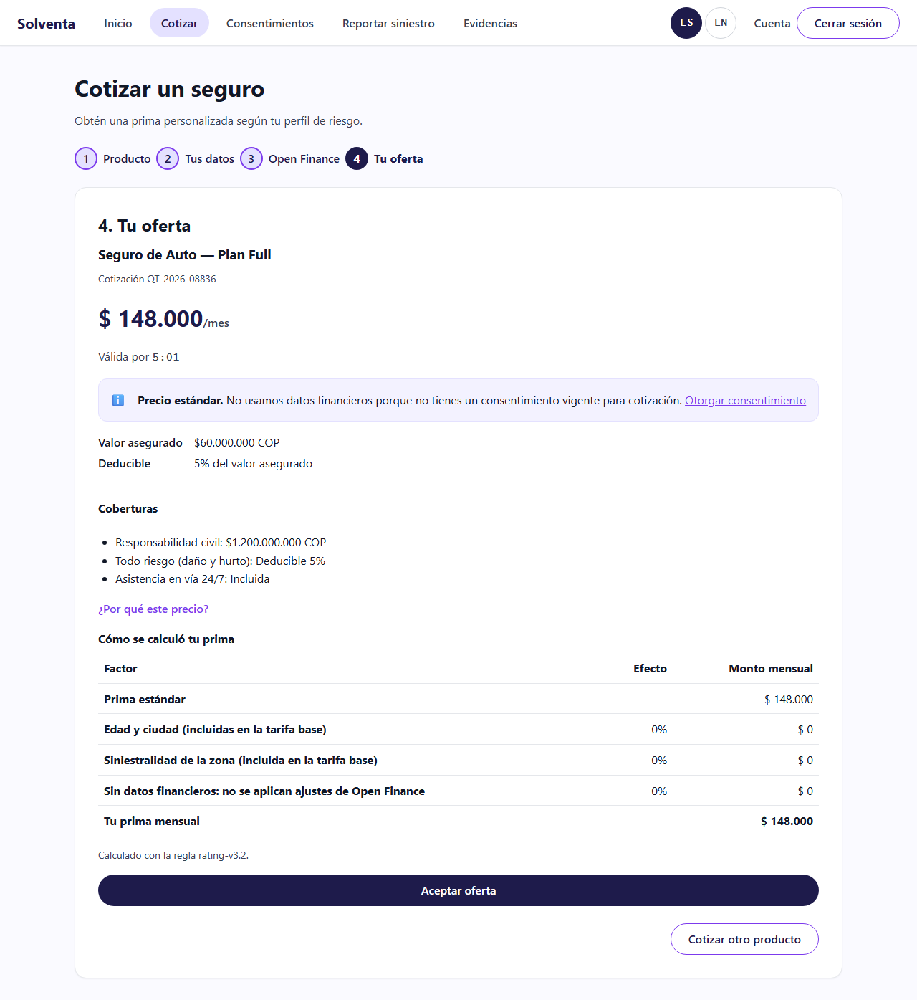
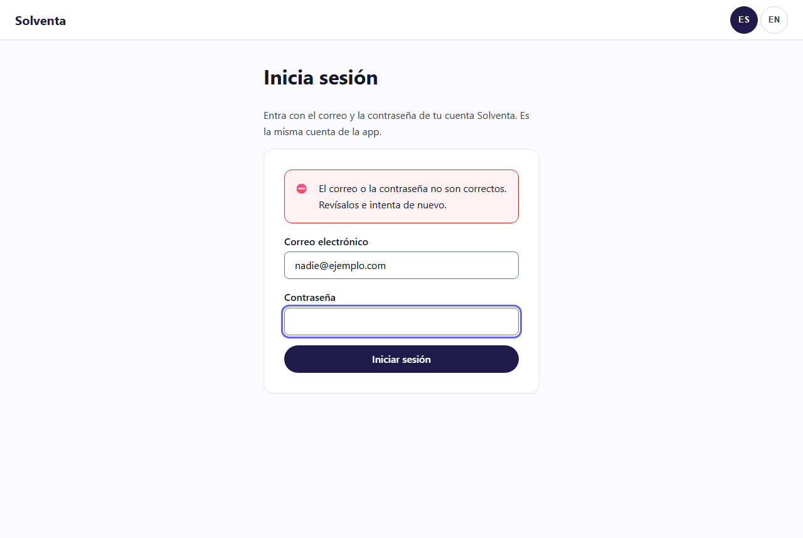
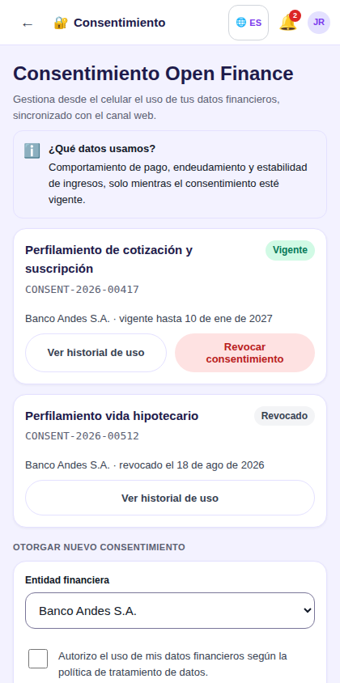
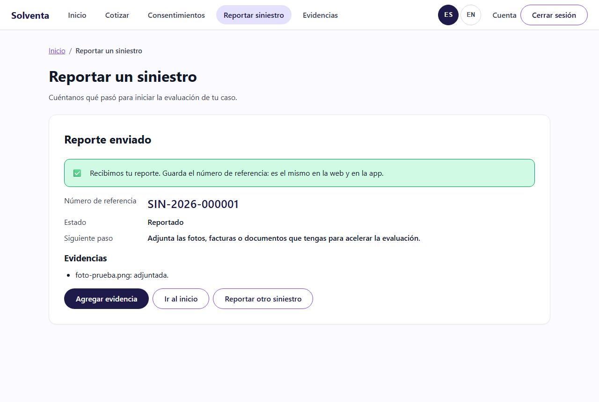
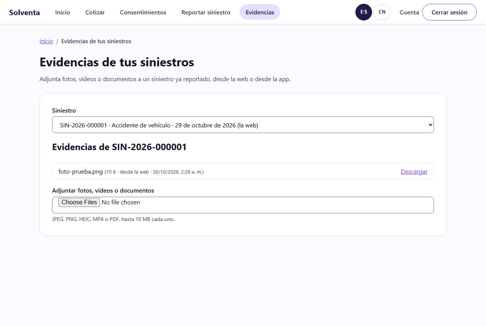

# Historias de Usuario Detalladas - Sprint 2 del Proyecto Final II

> **Proyecto:** Solventa · Aseguradora Digital de Finanzas Abiertas
> **Curso:** MISW4501 · Proyecto Final · Maestría en Ingeniería de Software · Universidad de los Andes
> **Grupo:** 13
> **Sprint:** 2 · semanas 3-4 del Proyecto Final II (19 oct - 1 nov 2026) · release `v0.2.0`

Sprint 2 lleva las historias de punta a punta: cada una se entrega con su interfaz web, su app
móvil, su backend, su paso por el BFF, su despliegue en *staging*, sus pruebas E2E y su
documentación. Son **cinco historias, 36 puntos**. Al cierre, un cliente entra con la misma cuenta
en la web y en la app, cotiza con su perfil de Open Finance, gestiona su consentimiento desde los
dos canales y reporta un siniestro con evidencia, todo contra servicios desplegados.

Este documento sigue las convenciones del [Sprint 1](HistoriasUsuarioSprint1.md#convenciones) y
detalla el Sprint 2 tal como quedó en el tablero (GitHub Project 4), con los ajustes respecto al
plan que se explican en [Ajuste respecto al plan](#ajuste-respecto-al-plan).

> **Ubicación de este archivo:** `docs/HistoriasUsuarioSprint2.md`. Las rutas relativas están
> escritas desde `docs/`.

---

## Tabla de contenido

- [Objetivo del Sprint 2](#objetivo-del-sprint-2)
- [Backlog del Sprint 2](#backlog-del-sprint-2)
- [Ajuste respecto al plan](#ajuste-respecto-al-plan)
- [Cómo se parte cada historia](#cómo-se-parte-cada-historia)
- [Historias](#historias)
  - [WEB-F01 · Cotización y oferta personalizada](#web-f01--cotización-y-oferta-personalizada)
  - [WEB-F13 · Sesión del cliente en web y app](#web-f13--sesión-del-cliente-en-web-y-app)
  - [MOB-F02 · Consentimiento Open Finance en web y app](#mob-f02--consentimiento-open-finance-en-web-y-app)
  - [WEB-F05 · Reportar un siniestro en web y app](#web-f05--reportar-un-siniestro-en-web-y-app)
  - [MOB-F05 · Evidencia del siniestro en web y app](#mob-f05--evidencia-del-siniestro-en-web-y-app)
- [Deuda del Sprint 1 entregada en este sprint](#deuda-del-sprint-1-entregada-en-este-sprint)
- [Trazabilidad a los requisitos de calidad](#trazabilidad-a-los-requisitos-de-calidad)
- [Asignación por integrante](#asignación-por-integrante)

---

## Objetivo del Sprint 2

**Objetivo del sprint:** que las historias dejen de ser pantallas contra mocks y pasen a ser
recorridos reales. Nace el servicio BFF ([ADR 0001](adr/0001-bff-unico-dos-routers.md)), la sesión
es real en los dos canales y todo se despliega en *staging* por el pipeline.

### Guion del demo de cierre

1. Una persona que se registró en la app entra a la web con el mismo correo y contraseña
   (WEB-F13).
2. Cotiza un seguro de auto en la web contra el BFF y el núcleo desplegados: con consentimiento
   vigente recibe una prima personalizada y en "¿Por qué este precio?" ve los factores y la versión
   de la regla (WEB-F01).
3. Desde la app revoca el consentimiento de cotización. Vuelve a cotizar en la web y recibe la
   tarifa estándar, explicada (MOB-F02).
4. Con el proveedor de Open Finance caído, cotiza de nuevo y recibe la oferta dentro del
   presupuesto de latencia, con el aviso de datos guardados o tarifa estándar (WEB-F01).
5. Reporta un siniestro desde la app con una foto con fecha y ubicación. Pulsa dos veces
   "Enviar reporte": queda un solo siniestro, con la misma referencia en la web (WEB-F05, MOB-F05).
6. Desde la web adjunta un documento más al mismo siniestro y lo ve en la app (MOB-F05).

---

## Backlog del Sprint 2

| ID | Historia | Épica | Puntos | Depende de | Issue |
|---|---|---|---:|---|---|
| WEB-F01 | Cotización y oferta personalizada | Venta | 13 | ARQ-02, WEB-F02, WEB-F13 | [#123](https://github.com/JuanJoseRestrepo33/Proyecto_Grupo_13/issues/123) |
| WEB-F13 | Sesión del cliente en web y app | Identidad y consentimiento | 5 | MOB-F01, WEB-F01 (base del BFF) | [#150](https://github.com/JuanJoseRestrepo33/Proyecto_Grupo_13/issues/150) |
| MOB-F02 | Consentimiento Open Finance en web y app | Identidad y consentimiento | 5 | WEB-F02, MOB-F01, WEB-F13 | [#127](https://github.com/JuanJoseRestrepo33/Proyecto_Grupo_13/issues/127) |
| WEB-F05 | Reportar un siniestro en web y app | Siniestros | 8 | ARQ-01, ARQ-03, WEB-F13 | [#125](https://github.com/JuanJoseRestrepo33/Proyecto_Grupo_13/issues/125) |
| MOB-F05 | Evidencia del siniestro en web y app | Siniestros | 5 | **WEB-F05**, MOB-F01 | [#126](https://github.com/JuanJoseRestrepo33/Proyecto_Grupo_13/issues/126) |
| | **Total del sprint** | | **36** | | |

> **ID:** el prefijo (`WEB`, `MOB`, `ARQ`) indica el origen del ID en el backlog, no el canal. Los
> canales los dice la tabla de partes de cada historia.

**Orden que imponen las dependencias:** la base del BFF (parte de Integración de WEB-F01) y la
sesión (WEB-F13) van primero, porque todas las demás pasan por ellas. MOB-F05 depende de WEB-F05:
sin un siniestro reportado no hay a qué adjuntar evidencia.

---

## Ajuste respecto al plan

El [plan de 8 semanas](backlog-sprint-plan.md) asignaba al Sprint 2 34 puntos: WEB-F01 (13),
MOB-F02 (5), WEB-F05 (8) y WEB-F06 (8). En la planeación del sprint el equipo lo ajustó así:

| Cambio | Por qué |
|---|---|
| **Entra WEB-F13** · Sesión del cliente (5), historia nueva | Sin sesión real ninguna historia es completa de punta a punta: todas correrían con un cliente sembrado. Absorbe el criterio pendiente de MOB-F01 (contraseña con hash y sal, evento `ClientRegistered`) |
| **Entra MOB-F05** · Evidencia del siniestro (5), adelantada del Sprint 3 | Va pegada al reporte de WEB-F05: el mismo asistente tiene el paso de evidencia. Su modo sin conexión sale a MOB-F05-02 (Sprint 3) |
| **Sale WEB-F06** · Seguimiento de siniestros (8), al Sprint 3 | Necesita siniestros reportados y con cambios de estado; se construye sobre WEB-F05 |
| **Todas las historias pasan a ser multicanal** | Cada historia trae su parte web y su parte móvil (o un *N/A* explícito), para que el mismo recorrido funcione en los dos canales |

Resultado: 36 puntos en lugar de 34. Las historias con más riesgo traen una **partición definida de
antemano** (ver [abajo](#cómo-se-parte-cada-historia)) para cerrar una parte completa si no alcanza
el sprint.

---

## Cómo se parte cada historia

Cada historia se reparte en **partes**, una por capa, y cada parte es una subtarea (sub-issue) en el
tablero con su responsable y su propio "hecho cuando":

| Parte | Qué entrega | "Hecho cuando" típico |
|---|---|---|
| Backend | Lógica del núcleo en su módulo | PR con pruebas unitarias y de integración; cobertura del código nuevo ≥ 70 % |
| Integración | Rutas del BFF y su contrato | Contrato validado con Redocly; ruta implementada y con prueba |
| Web / Móvil | Pantallas contra el BFF real | Sin mocks; accesibilidad y textos en i18n |
| Cloud | Despliegue, datos y secretos en *staging* | Desplegado por `cd.yml` con prueba de humo, sin credenciales en el repo |
| E2E web / E2E móvil | El recorrido completo contra *staging* | Playwright o Espresso en verde en el CI |
| Documentación | Historia, guía de usuario y changelog de los contratos | PR con este documento, la guía y los `CHANGELOG.md` |

**La historia se cierra solo cuando todas sus partes están en *Done*.** Una historia con su
partición A/B, si en el punto de control del sprint no va a llegar completa, cierra la parte A y
mueve la B; cada parte sigue siendo una historia completa en sí misma.

---

## Historias

### WEB-F01 · Cotización y oferta personalizada

**Como** cliente, **quiero** cotizar un seguro indicando qué quiero asegurar y recibir una oferta con
precio personalizado y explicado, **para** decidir con información y no a ciegas.

La interfaz del cotizador quedó en el Sprint 1 (PR #120), contra mocks, y con ARQ-02 (PR #117) el
núcleo ya obtiene el perfil de Open Finance. Esta historia une las partes de punta a punta: la web
cotiza contra la API real a través del BFF, la cotización se persiste y es idempotente, y todo se
despliega. **Aquí nace el servicio BFF** que usan todas las historias siguientes.

**Criterios de aceptación**

1. Dado un cliente con consentimiento vigente para la finalidad de cotización, cuando cotiza desde
   la web contra la API real, entonces recibe una prima personalizada, ve el ahorro frente a la
   tarifa estándar y, en "¿Por qué este precio?", los factores con los que el motor la calculó y la
   versión de la regla.
2. Dado un cliente sin consentimiento vigente o que lo revocó, cuando cotiza, entonces recibe la
   tarifa estándar y la interfaz explica por qué, sin presentarlo como un error.
3. Dado el proveedor de Open Finance degradado o caído, cuando el cliente cotiza, entonces recibe la
   oferta dentro del presupuesto de latencia, y la interfaz indica si se usaron datos guardados o la
   tarifa estándar (P14).
4. Dado un cliente que repite la misma solicitud mientras su oferta sigue vigente, cuando cotiza de
   nuevo, entonces recibe la misma cotización y no una nueva.
5. Dada una cotización emitida, cuando el núcleo se reinicia, entonces la cotización sigue
   consultable con su estado. Con los datos de su decisión auditada (`version_regla` y
   `variables_entrada`), la prima se recalcula y da el mismo valor (RC-08).
6. Dados datos inválidos, cuando el cliente intenta avanzar, entonces cada campo muestra el error
   del dominio (por ejemplo, edad fuera del rango asegurable) y no se calcula prima hasta
   corregirlo.

**Partes de la historia**

| Parte | Alcance | Responsable | Issue |
|---|---|---|---|
| Backend | Cotización con perfil de Open Finance, persistencia en Cloud SQL (esquema propio del módulo) e idempotencia | Sergio | #129 |
| Integración | Base del servicio BFF en `bff/` (un servicio con dos routers: `/api/v1/web/` y `/api/v1/movil/`, cada uno con su contrato) y ruta de cotización | Sergio | #164 |
| Web | Cotizador contra la API real: deja los mocks y muestra la degradación con datos reales | Harold | #128 |
| Cloud | BFF y web en Cloud Run con el mismo `cd.yml`; esquema de cotización en el Cloud SQL de la auditoría; humo de los servicios | Juan | #165 |
| E2E web | Playwright en el CI (job `e2e`) + inicio de sesión → cotizar con consentimiento, sin consentimiento y con Open Finance caído | Harold | #166 |
| Documentación | ADR del BFF único, esta historia y la guía de usuario (cotización) | Juan | #167 |
| Móvil | *N/A:* cotizar desde la app es MOB-F04, fuera del MVP por decisión del equipo | - | - |

**Partición definida de antemano**

| | Alcance | Puntos |
|---|---|---:|
| **A** (se cierra) | Cotización personalizada con explicación, tarifa estándar sin consentimiento y validaciones (crit. 1, 2, 6) | 8 |
| **B** (se mueve) | Degradación con Open Finance caído, idempotencia y recálculo tras reinicio (crit. 3, 4, 5) | 5 |

**Notas técnicas**

- **Un solo BFF con dos routers y dos contratos** ([ADR 0001](adr/0001-bff-unico-dos-routers.md)).
  Vive en `bff/`, hermano de `backend/`, fuera de las reglas del monolito modular. Las diferencias
  entre el contrato `bff-web` y la API `/v1` del núcleo se resuelven en el BFF, no en la interfaz.
- **Tres servicios en Cloud Run**, desplegados en orden por `cd.yml`: `solventa-nucleo`,
  `solventa-bff` y `solventa-web` (nginx que sirve la web y reenvía `/api/` al BFF). La web y el BFF
  comparten origen, así la cookie de sesión funciona sin CORS. Detalle en
  [`devops.md`](devops.md#despliegue-continuo).
- **Persistencia:** la cotización tiene su esquema y su usuario en la instancia de Cloud SQL de la
  auditoría (`COTIZACION_DATABASE_URL`). El usuario de cotización no puede leer el esquema de
  auditoría. Es lo que hace verificable el criterio 5 en *staging*: una cotización sobrevive a una
  revisión nueva del núcleo.
- **Prueba de humo** en [`scripts/humo.py`](../scripts/humo.py): núcleo, BFF y web a través del
  proxy.

**Patrones de interfaz.** P04 Asistente paso a paso con puertas de validación · P05 Tarjetas de
opción · P06 Validación en línea · P14 Degradación elegante · P15 Oferta con vigencia · P16
Explicabilidad del precio.
**Capturas** (*staging*, 30 oct 2026).
[`web-staging-cotizacion-oferta.png`](guia-de-usuario/img/web-staging-cotizacion-oferta.png):
cotización contra el BFF y el núcleo desplegados, con la tarifa estándar explicada y el desglose de
"¿Por qué este precio?".

**Favorece** RC-01 Latencia, RC-08 Trazabilidad y explicabilidad ·
**Puntos** 13 · **Responsables** Sergio (backend, integración), Harold (web, E2E), Juan (cloud,
documentación) · **Depende de** ARQ-02, WEB-F02, WEB-F13

---

### WEB-F13 · Sesión del cliente en web y app

**Como** cliente, **quiero** entrar con la misma cuenta en la web y en la app, **para** continuar mis
trámites en cualquier canal.

Historia nueva del sprint. Absorbe el criterio pendiente de MOB-F01 (contraseña con hash y sal,
evento `ClientRegistered`). Sin sesión real ninguna historia es completa de punta a punta: todas
correrían con un cliente sembrado. Desde esta historia, las demás parten de un inicio de sesión
real.

**Criterios de aceptación**

1. Dado un cliente que se registró en la app (MOB-F01), cuando inicia sesión en la web con su correo
   y contraseña, entonces entra a su cuenta sin un registro adicional.
2. Dado un registro nuevo, cuando se completa, entonces la contraseña queda guardada con hash y sal,
   nunca en claro, y el núcleo publica el evento `ClientRegistered`.
3. Dadas credenciales inválidas, cuando el cliente intenta entrar en cualquiera de los dos canales,
   entonces ve un mensaje genérico que no revela si el correo existe.
4. Dada una sesión vencida, cuando el cliente hace una operación, entonces la web le pide iniciar
   sesión de nuevo y la app renueva la sesión o, si no puede, vuelve al inicio de sesión (con huella
   si está activa).
5. Dada la suite E2E del sprint, cuando corre contra *staging*, entonces todos los flujos parten de
   un inicio de sesión real, sin clientes sembrados en la interfaz.

**Partes de la historia**

| Parte | Alcance | Responsable | Issue |
|---|---|---|---|
| Backend | Credenciales con hash y sal, evento `ClientRegistered`, emisión y validación del token en el módulo `identidad` | Sergio | #151 |
| Integración | `/sesion` en el router web; `/registros` y `/sesiones` en el router móvil | Sergio | #152 |
| Web | Pantallas de inicio y cierre de sesión; rutas protegidas | Harold | #153 |
| Móvil | Registro e inicio de sesión contra el BFF real (las pantallas ya existen de MOB-F01) | Edwin | #154 |
| Cloud | Llave de firma de tokens en Secret Manager, montada en el BFF y en el núcleo; humo de `/sesion` en *staging* | Juan | #155 |
| E2E web | Inicio de sesión válido e inválido | Harold | #156 |
| E2E móvil | Registro → inicio de sesión → sesión renovada | Edwin | #157 |
| Documentación | Esta historia, la guía de usuario (inicio de sesión) y el changelog de los contratos | Juan | #158 |

**Notas técnicas**

- **Contraseñas con scrypt** (2^14 iteraciones, 8 bloques, sal aleatoria por cuenta). Se guarda solo
  la derivación, con sus parámetros, para poder subir el costo sin invalidar las existentes. El
  registro verifica el correo con un código de 6 dígitos que vence a los 10 minutos y admite 3
  intentos.
- **Tokens ES256 firmados por el núcleo.** El núcleo firma con la llave privada y el BFF solo valida
  con la pública: un BFF comprometido no puede emitir sesiones. El `kid` es la huella JWK de la llave
  pública (RFC 7638), así que durante una rotación el BFF acepta la actual y la anterior. Las llaves
  viven en Secret Manager ([`devops.md`, paso 6](devops.md#6-llaves-de-firma-de-los-tokens-de-sesión-web-f13)).
- **Cada canal guarda la sesión a su manera.** La web recibe la cookie `sesion` (`HttpOnly`,
  `Secure`, `SameSite=Lax`, `Path=/api/v1/web`) y nunca ve el token; dura 60 minutos y no se renueva.
  La app recibe un token de acceso de 15 minutos y uno de refresco de 30 días que **rota** en cada
  uso: un refresco ya usado no vale aunque alguien lo haya copiado.
- **Un solo mensaje para credenciales inválidas** (`credenciales_invalidas`), exista o no el correo.
- **La cuenta de prueba de *staging*** la siembra el núcleo al arrancar con `HUMO_CORREO` y
  `HUMO_CLAVE`; la usan la prueba de humo y las E2E. Nunca se define en producción.

**Patrones de interfaz.** P06 Validación en línea · P10 Botón ocupado.
**Capturas** (*staging*, 30 oct 2026).
[`web-staging-login.png`](guia-de-usuario/img/web-staging-login.png) ·
[`web-staging-login-error.png`](guia-de-usuario/img/web-staging-login-error.png) (mensaje
genérico, criterio 3). *Pendiente:* la de la app contra *staging*
([`mob-login.png`](guia-de-usuario/img/mob-login.png) es del prototipo), cuando la app hable con el
BFF real (#154).

**Favorece** RC-04 Seguridad y privacidad ·
**Puntos** 5 · **Responsables** Sergio (backend, integración), Harold (web, E2E web), Edwin (móvil,
E2E móvil), Juan (cloud, documentación) · **Depende de** MOB-F01, WEB-F01 (base del BFF)

---

### MOB-F02 · Consentimiento Open Finance en web y app

**Como** cliente, **quiero** otorgar, consultar y revocar mi consentimiento de Open Finance desde la
app con el mismo efecto que en la web, **para** tener el mismo control sin cambiar de canal.

El consentimiento es del cliente, no del canal. WEB-F02 (Sprint 1) dejó la API y la web; esta
historia lleva al móvil las mismas reglas sobre la misma API desplegada, incluida la que más
importa: revocar corta el acceso de inmediato en todos los canales.

**Criterios de aceptación**

1. Dado un cliente con sesión en la app, cuando abre consentimientos, entonces ve las mismas
   finalidades, alcances, vigencias y estados que en la web, adaptados al formato del canal.
2. Dado un consentimiento otorgado o revocado desde la web, cuando el cliente abre o refresca la
   app, entonces ve el mismo estado, y viceversa.
3. Dada una finalidad sin consentimiento, cuando el cliente la otorga, entonces elige las entidades
   de origen (ninguna viene marcada) y acepta la versión vigente del texto legal. Queda registrado el
   canal `movil`.
4. Dado un consentimiento vigente, cuando el cliente lo revoca y confirma, entonces la siguiente
   cotización de ese cliente, desde cualquier canal, usa la tarifa estándar (RC-04, P07).
5. Dado un consentimiento a 30 días o menos de vencer, cuando el cliente abre la app, entonces lo ve
   marcado y puede renovarlo sin repetir el flujo completo.

**Partes de la historia**

| Parte | Alcance | Responsable | Issue |
|---|---|---|---|
| Backend | Canal `movil` en la API de consentimiento | Sergio | #159 |
| Integración | Rutas de consentimiento en el router móvil (`bff-movil` 0.2.0), con los mismos códigos de error que el router web | Sergio | #160 |
| Móvil | Consentimiento en la app: listar, otorgar, revocar y renovar | Edwin | #133 |
| Cloud | Humo de las rutas de consentimiento del router móvil en *staging* | Juan | #161 |
| E2E móvil | Otorgar y revocar en la app → la web muestra el mismo estado y la siguiente cotización usa la tarifa estándar | Edwin | #162 |
| Documentación | Esta historia, la guía de usuario (consentimiento en la app) y el changelog de `bff-movil` | Juan | #163 |
| Web | *N/A:* quedó cerrada en el Sprint 1 con WEB-F02. La verificación entre canales está en el E2E móvil | - | - |

**Notas técnicas**

- **Una sola API para los dos canales.** El BFF reenvía al núcleo el canal (`X-Canal: movil`) y el
  núcleo lo guarda en cada otorgamiento, revocación y renovación, y en el log de auditoría. El estado
  es uno solo: lo que se cambia en un canal ya está en el otro.
- **La app no muestra el `mensaje` del error tal cual:** traduce el código del contrato a un texto
  propio. Tras un conflicto (`409`), bloquea las acciones hasta volver a consultar el estado, para
  no actuar sobre un dato viejo.
- **Humo en *staging*:** las cinco rutas del router móvil responden 401 sin sesión, y con la cuenta
  de prueba el catálogo trae sus tres finalidades (`cotizacion`, `suscripcion`,
  `prevencion_fraude`).

**Patrones de interfaz.** P07 Confirmación de acciones destructivas o irreversibles · P08
Consentimiento explícito y revocable.
**Capturas.** [`mob-consentimiento.png`](guia-de-usuario/img/mob-consentimiento.png). *Pendiente:*
reemplazarla por la captura de la app contra *staging*.

**Favorece** RC-04 Seguridad y privacidad ·
**Puntos** 5 · **Responsables** Sergio (backend, integración), Edwin (móvil, E2E), Juan (cloud,
documentación) · **Depende de** WEB-F02, MOB-F01, WEB-F13

---

### WEB-F05 · Reportar un siniestro en web y app

**Como** cliente asegurado, **quiero** reportar un siniestro desde la web o desde la app con ayuda
paso a paso, **para** iniciar la reclamación sin llamar a nadie y sin saber de antemano qué datos me
van a pedir.

Es el primer momento de verdad después de la venta. El reporte es el mismo en los dos canales:
mismo servicio, misma referencia, misma clave de idempotencia. La evidencia es MOB-F05; el modo sin
conexión, MOB-F05-02 (Sprint 3).

**Criterios de aceptación**

1. Dado un cliente con al menos una póliza vigente, cuando completa los tres pasos del asistente
   (información, evidencia, revisión) en la web o en la app y envía, entonces queda un siniestro en
   estado *reportado*; el cliente ve un número de referencia y el siguiente paso de su caso, y el
   mismo siniestro se ve en los dos canales.
2. Dado el paso de información, cuando el cliente intenta continuar sin póliza, tipo de evento,
   fecha o descripción, entonces el asistente no avanza e indica qué falta en cada campo. Una fecha
   futura se rechaza.
3. Dada una póliza vencida, cuando el cliente reporta un evento ocurrido dentro de su vigencia,
   entonces el reporte se acepta. Si el evento es posterior a la vigencia, se le explica por qué no
   procede y no queda registro.
4. Dado un doble clic en "Enviar reporte" o un reintento por una red lenta, en cualquiera de los dos
   canales, cuando llega la segunda solicitud, entonces el botón está ocupado y el núcleo no crea un
   segundo siniestro: devuelve el mismo número de referencia (P10, P18).
5. Dado un reporte creado, cuando se consulta el log de auditoría, entonces el reporte está ahí con
   la póliza, el tipo de evento, el canal (`web` o `movil`) y la marca de tiempo, y se publicó el
   evento de siniestro reportado.

**Partes de la historia**

| Parte | Alcance | Responsable | Issue |
|---|---|---|---|
| Backend | Servicio de reporte de siniestros, pólizas de prueba por la interfaz pública de `polizas`, clave de idempotencia y evento de siniestro reportado | Sergio | #135 |
| Integración | Contrato y rutas de siniestros en los dos routers del BFF | Sergio | #168 |
| Web | Asistente de reporte en tres pasos (información, evidencia opcional, revisión) y confirmación | Harold | #132 |
| Móvil | Asistente de reporte en la app y confirmación con la referencia | Edwin | #169 |
| Cloud | Esquema de siniestros en el Cloud SQL de *staging*, pólizas de prueba sembradas y humo de las rutas | Juan | #170 |
| E2E web | Tres pasos y doble envío idempotente | Harold | #171 |
| E2E móvil | Reporte desde la app; la misma referencia aparece en la web | Edwin | #172 |
| Documentación | Esta historia, la guía de usuario (reporte de siniestro) y el changelog de los contratos | Juan | #173 |

**Partición definida de antemano**

| | Alcance | Puntos |
|---|---|---:|
| **A** (se cierra) | Reporte en web y app sobre póliza vigente, validado, idempotente y auditado (crit. 1, 2, 4, 5) | 5 |
| **B** (se mueve) | Póliza vencida con evento dentro de la vigencia, en web y app (crit. 3) | 3 |

**Notas técnicas**

- **La idempotencia vive en la base, no en memoria.** Cada envío del asistente lleva su
  `Idempotency-Key`, generada por el cliente. La clave es única por cliente en la tabla
  `siniestros.siniestros`, así que el doble envío devuelve la misma referencia aunque el núcleo se
  reinicie entre las dos solicitudes. La misma clave con otros datos responde
  `clave_idempotencia_en_uso`.
- **La vigencia se valida por la interfaz pública de `polizas`** (ARQ-01), nunca leyendo sus datos.
  El módulo de pólizas aún no persiste (la emisión es WEB-F03): en *staging* carga al arrancar la
  semilla [`backend/semillas/polizas-staging.json`](../backend/semillas/polizas-staging.json), con
  una póliza de auto y una de viaje vigentes y una de hogar vencida, con fechas relativas al arranque.
- **Persistencia en *staging*:** esquema y usuario `siniestros` en la instancia de Cloud SQL, sin
  acceso a los esquemas de auditoría ni de cotización
  ([`devops.md`, paso 8](devops.md#8-siniestros-y-pólizas-de-prueba-web-f05)).
- **Auditoría:** cada reporte deja un registro `siniestro_reportado` con el canal en el log
  inmutable de ARQ-03 y publica el evento `siniestro-reportado`.

**Patrones de interfaz.** P02 Migas de pan y barra de flujo · P04 Asistente paso a paso con puertas
de validación · P06 Validación en línea · P10 Botón ocupado · P18 Idempotencia comunicada.
**Capturas** (*staging*, 30 oct 2026).
[`web-staging-siniestro-informacion.png`](guia-de-usuario/img/web-staging-siniestro-informacion.png) ·
[`web-staging-siniestro-confirmacion.png`](guia-de-usuario/img/web-staging-siniestro-confirmacion.png):
reporte sobre la póliza sembrada, con la referencia y el siguiente paso. *Pendiente:* la de la app
([`mob-siniestro-reportar.png`](guia-de-usuario/img/mob-siniestro-reportar.png) es del prototipo),
con el asistente móvil (#169).

**Favorece** RC-05 Auditabilidad, RC-08 Trazabilidad y explicabilidad ·
**Puntos** 8 · **Responsables** Sergio (backend, integración), Harold (web, E2E web), Edwin (móvil,
E2E móvil), Juan (cloud, documentación) · **Depende de** ARQ-01, ARQ-03, WEB-F13

---

### MOB-F05 · Evidencia del siniestro en web y app

**Como** cliente asegurado, **quiero** adjuntar fotos, videos o documentos a mi siniestro desde la
app o desde la web, **para** dejar la evidencia en el momento y acelerar la evaluación de mi caso.

El móvil aporta la cámara y la ubicación en el momento del evento; la web, la carga de archivos. La
evidencia se puede agregar en el reporte o después. El modo sin conexión salió a MOB-F05-02
(Sprint 3).

**Criterios de aceptación**

1. Dado el paso de evidencia en la app, cuando el cliente toma una foto con la cámara, entonces la
   foto queda con la fecha y hora y, si concedió el permiso de ubicación, con la ubicación del
   evento.
2. Dado un cliente que niega el permiso de cámara o de ubicación, cuando llega al paso de evidencia,
   entonces la app explica para qué lo necesita y ofrece una alternativa: elegir de la galería o
   escribir el lugar. El reporte no queda bloqueado (P20).
3. Dada una foto o video que supera 10 MB en la app, cuando se adjunta, entonces la app la comprime
   antes de enviar. Si aun así no cabe, lo explica y ofrece eliminarla.
4. Dado el paso de evidencia en la web, cuando el cliente adjunta un archivo de un formato no
   admitido o de más de 10 MB, entonces se rechaza antes de enviar, con el límite explicado.
5. Dado un siniestro ya reportado, cuando el cliente agrega evidencia después desde cualquiera de
   los dos canales, entonces queda asociada al mismo siniestro y se ve en ambos.

**Partes de la historia**

| Parte | Alcance | Responsable | Issue |
|---|---|---|---|
| Backend | Carga de evidencia detrás de un puerto de almacenamiento de archivos | Sergio | #174 |
| Integración | Rutas de evidencia en los dos routers del BFF | Sergio | #175 |
| Web | Adjuntar archivos en el paso de evidencia y después del reporte, con validación de formato y tamaño | Harold | #176 |
| Móvil | Foto con fecha y ubicación, compresión y permisos con alternativa | Edwin | #137 |
| Cloud | Bucket de evidencias en Cloud Storage, adaptador y permisos de la cuenta de servicio | Juan | #177 |
| E2E web | Adjuntar un archivo válido y rechazar uno inválido | Harold | #178 |
| E2E móvil | Reporte con foto sin duplicar el siniestro | Edwin | #179 |
| Documentación | Esta historia, la guía de usuario (evidencia) y el changelog de los contratos | Juan | #180 |

**Notas técnicas**

- **Formatos y tamaño:** JPEG, PNG, HEIC, MP4 y PDF, hasta 10 MB por archivo. El núcleo valida el
  tipo real del contenido, no solo el declarado; los canales validan antes de enviar para no gastar
  la subida.
- **Un puerto de almacenamiento** (`AlmacenDeEvidencias`) con dos adaptadores: en memoria para
  desarrollo y pruebas, Cloud Storage en *staging*. Ninguno tiene operación de borrar, y guardar dos
  veces la misma evidencia falla en lugar de sobrescribirla (en Cloud Storage, con la precondición
  `if_generation_match=0`).
- **Bucket privado:** acceso uniforme, acceso público bloqueado y ningún objeto con URL pública; la
  lectura pasa por el núcleo y el BFF con la sesión del cliente. La cuenta del núcleo solo puede
  crear y leer objetos de ese bucket, no borrarlos. El objeto se llama
  `siniestros/{siniestro}/{evidencia}`, sin datos del cliente; el nombre original va en sus metadatos
  ([`devops.md`, paso 7](devops.md#7-bucket-de-evidencias-de-siniestros-mob-f05)).
- **nginx acepta cuerpos de hasta 12 MB** en `/api/`, para que una evidencia de 10 MB llegue al BFF
  desde la web.

**Patrones de interfaz.** P06 Validación en línea · P10 Botón ocupado · P20 Permiso en contexto
con alternativa.
**Capturas** (*staging*, 30 oct 2026).
[`web-staging-siniestro-evidencia.png`](guia-de-usuario/img/web-staging-siniestro-evidencia.png) ·
[`web-staging-siniestro-evidencias.png`](guia-de-usuario/img/web-staging-siniestro-evidencias.png):
la evidencia quedó en el bucket de Cloud Storage y se lista con su canal de origen. *Pendiente:* la
de la app con la foto y la misma evidencia vista desde el otro canal (#137).

**Favorece** RC-04 Seguridad y privacidad ·
**Puntos** 5 · **Responsables** Sergio (backend, integración), Harold (web, E2E web), Edwin (móvil,
E2E móvil), Juan (cloud, documentación) · **Depende de** **WEB-F05**, MOB-F01

---

## Deuda del Sprint 1 entregada en este sprint

El [documento del Sprint 1](HistoriasUsuarioSprint1.md#historias-funcionales-en-curso) dejó tres
historias en curso con una rebanada verificable cada una. Solo una llegó al código en el Sprint 1:
la interfaz del cotizador de WEB-F01 (PR #120). **Las otras dos no:**

| Historia | Rebanada comprometida en el Sprint 1 | Qué pasó |
|---|---|---|
| WEB-F03 · Suscripción y emisión | Armazón del checkout con los estados de la transacción: botón ocupado, reintento sin segundo cobro y migas de pan (criterios 1-3 de la rebanada) | No se implementó ni quedó registrada en el tablero. Se detectó al revisar el repositorio en este sprint y se entregó en el PR #219: pantalla `/suscripcion/:cotizacion` contra los mocks del contrato `bff-web` 0.4.0 |
| MOB-F02 · Consentimiento móvil | Pantalla de consentimiento en la app con las mismas finalidades y el mismo estado que la web (criterios 1-2 de la rebanada) | Quedó el prototipo navegable (`mobile-docs/consentimiento.html`) y su captura, pero no la pantalla en la app: `mobile/android` solo tiene `feature/onboarding`. La absorbe la parte móvil de MOB-F02 en este sprint ([#133](https://github.com/JuanJoseRestrepo33/Proyecto_Grupo_13/issues/133)), que construye el módulo `feature/consentimiento` completo |

Lo que sigue de WEB-F03 (firma, emisión, documento y conexión al BFF real) queda en el Sprint 3,
con la historia [#138](https://github.com/JuanJoseRestrepo33/Proyecto_Grupo_13/issues/138).

**Lección para el equipo:** una rebanada "en curso" que no tiene issue propio en el tablero no se
ve en el seguimiento del sprint. Desde este sprint, cada parte es un sub-issue con su "hecho
cuando".

---

## Trazabilidad a los requisitos de calidad

| Requisito de calidad | Historias del Sprint 2 | Qué queda para después |
|---|---|---|
| **RC-01 Latencia** - cotización p95 ≤ 250 ms | WEB-F01 (criterio 3: oferta dentro del presupuesto con Open Finance caído) | Autoescalado y caché distribuida (Sprint 4) |
| **RC-02 Escalabilidad de eventos** | ninguna | Siniestros paramétricos (Sprint 3) |
| **RC-03 Disponibilidad** | ninguna directa; el despliegue por `cd.yml` con humo evita promover revisiones rotas | Redundancia multi-zona (Sprint 4) |
| **RC-04 Seguridad y privacidad** | WEB-F13 (hash y sal, firma de tokens), MOB-F02 (revocación desde la app), MOB-F05 (permisos con alternativa, bucket privado) | mTLS entre servicios, API Gateway (Sprint 4) |
| **RC-05 Auditabilidad** | WEB-F05 (criterio 5: reporte en el log de auditoría con canal) | Publish/subscribe para consumidores adicionales (Sprint 3) |
| **RC-08 Trazabilidad y explicabilidad** | WEB-F01 (factores, versión de la regla y recálculo), WEB-F05 | - |

---

## Asignación por integrante

Cada integrante tiene la misma parte en todas las historias, salvo donde la historia no la necesita:

| Persona | Rol en el sprint | Partes |
|---|---|---|
| **Sergio** | Backend e integración | Backend e Integración de las cinco historias, incluida la base del BFF (WEB-F01) |
| **Harold** | Web | Web y E2E web de WEB-F01, WEB-F13, WEB-F05 y MOB-F05 |
| **Edwin** | Móvil | Móvil y E2E móvil de WEB-F13, MOB-F02, WEB-F05 y MOB-F05 |
| **Juan** | Cloud y documentación | Cloud y Documentación de las cinco historias |

**El riesgo de este sprint** es la base del BFF: todas las historias pasan por él y la sesión
(WEB-F13) también. Para no bloquear al resto, los nombres que comparten la infraestructura y el
código (URL del núcleo, cadenas de conexión, llaves de firma, bucket de evidencias) se acordaron
por escrito al inicio del sprint y viven en
[`devops.md`](devops.md#nombres-acordados-entre-componentes).

---

**Proyecto Final** · MISW4501 · Maestría en Ingeniería de Software · Universidad de los Andes · Grupo 13
