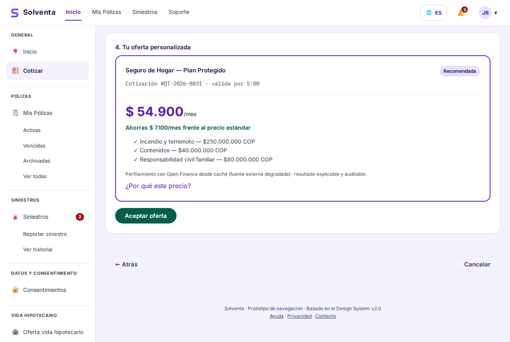

# Historias de Usuario Detalladas - Sprint 2 del Proyecto Final II

> **Proyecto:** Solventa · Aseguradora Digital de Finanzas Abiertas
> **Curso:** MISW4501 · Proyecto Final · Maestría en Ingeniería de Software · Universidad de los Andes
> **Grupo:** 13
> **Sprint:** 2 · semanas 3-4 del Proyecto Final II (19 oct - 1 nov 2026) · release `v0.2.0`

Sprint 2 lleva las historias de punta a punta: cada una se entrega con su interfaz web, su app
móvil, su backend, su paso por el BFF, su despliegue en *staging*, sus pruebas E2E y su
documentación. Son **cinco historias, 36 puntos**. Al cierre, un cliente entra con la misma cuenta
en la web y en la app, cotiza con su perfil de Open Finance, gestiona su consentimiento desde los
dos canales y reporta un siniestro con evidencia, todo contra servicios desplegados.

Este documento sigue las convenciones del [Sprint 1](HistoriasUsuarioSprint1.md#convenciones) y
detalla el Sprint 2 tal como quedó en el tablero (GitHub Project 4), con los ajustes respecto al
plan que se explican en [Ajuste respecto al plan](#ajuste-respecto-al-plan).

> **Ubicación de este archivo:** `docs/HistoriasUsuarioSprint2.md`. Las rutas relativas están
> escritas desde `docs/`.

---

## Tabla de contenido

- [Objetivo del Sprint 2](#objetivo-del-sprint-2)
- [Backlog del Sprint 2](#backlog-del-sprint-2)
- [Ajuste respecto al plan](#ajuste-respecto-al-plan)
- [Cómo se parte cada historia](#cómo-se-parte-cada-historia)
- [Historias](#historias)
  - [WEB-F01 · Cotización y oferta personalizada](#web-f01--cotización-y-oferta-personalizada)
  - [WEB-F13 · Sesión del cliente en web y app](#web-f13--sesión-del-cliente-en-web-y-app)
  - [MOB-F02 · Consentimiento Open Finance en web y app](#mob-f02--consentimiento-open-finance-en-web-y-app)
  - [WEB-F05 · Reportar un siniestro en web y app](#web-f05--reportar-un-siniestro-en-web-y-app)
  - [MOB-F05 · Evidencia del siniestro en web y app](#mob-f05--evidencia-del-siniestro-en-web-y-app)
- [Deuda del Sprint 1 entregada en este sprint](#deuda-del-sprint-1-entregada-en-este-sprint)
- [Trazabilidad a los requisitos de calidad](#trazabilidad-a-los-requisitos-de-calidad)
- [Asignación por integrante](#asignación-por-integrante)

---

## Objetivo del Sprint 2

**Objetivo del sprint:** que las historias dejen de ser pantallas contra mocks y pasen a ser
recorridos reales. Nace el servicio BFF ([ADR 0001](adr/0001-bff-unico-dos-routers.md)), la sesión
es real en los dos canales y todo se despliega en *staging* por el pipeline.

### Guion del demo de cierre

1. Una persona que se registró en la app entra a la web con el mismo correo y contraseña
   (WEB-F13).
2. Cotiza un seguro de auto en la web contra el BFF y el núcleo desplegados: con consentimiento
   vigente recibe una prima personalizada y en "¿Por qué este precio?" ve los factores y la versión
   de la regla (WEB-F01).
3. Desde la app revoca el consentimiento de cotización. Vuelve a cotizar en la web y recibe la
   tarifa estándar, explicada (MOB-F02).
4. Con el proveedor de Open Finance caído, cotiza de nuevo y recibe la oferta dentro del
   presupuesto de latencia, con el aviso de datos guardados o tarifa estándar (WEB-F01).
5. Reporta un siniestro desde la app con una foto con fecha y ubicación. Pulsa dos veces
   "Enviar reporte": queda un solo siniestro, con la misma referencia en la web (WEB-F05, MOB-F05).
6. Desde la web adjunta un documento más al mismo siniestro y lo ve en la app (MOB-F05).

---

## Backlog del Sprint 2

| ID | Historia | Épica | Puntos | Depende de | Issue |
|---|---|---|---:|---|---|
| WEB-F01 | Cotización y oferta personalizada | Venta | 13 | ARQ-02, WEB-F02, WEB-F13 | [#123](https://github.com/JuanJoseRestrepo33/Proyecto_Grupo_13/issues/123) |
| WEB-F13 | Sesión del cliente en web y app | Identidad y consentimiento | 5 | MOB-F01, WEB-F01 (base del BFF) | [#150](https://github.com/JuanJoseRestrepo33/Proyecto_Grupo_13/issues/150) |
| MOB-F02 | Consentimiento Open Finance en web y app | Identidad y consentimiento | 5 | WEB-F02, MOB-F01, WEB-F13 | [#127](https://github.com/JuanJoseRestrepo33/Proyecto_Grupo_13/issues/127) |
| WEB-F05 | Reportar un siniestro en web y app | Siniestros | 8 | ARQ-01, ARQ-03, WEB-F13 | [#125](https://github.com/JuanJoseRestrepo33/Proyecto_Grupo_13/issues/125) |
| MOB-F05 | Evidencia del siniestro en web y app | Siniestros | 5 | **WEB-F05**, MOB-F01 | [#126](https://github.com/JuanJoseRestrepo33/Proyecto_Grupo_13/issues/126) |
| | **Total del sprint** | | **36** | | |

> **ID:** el prefijo (`WEB`, `MOB`, `ARQ`) indica el origen del ID en el backlog, no el canal. Los
> canales los dice la tabla de partes de cada historia.

**Orden que imponen las dependencias:** la base del BFF (parte de Integración de WEB-F01) y la
sesión (WEB-F13) van primero, porque todas las demás pasan por ellas. MOB-F05 depende de WEB-F05:
sin un siniestro reportado no hay a qué adjuntar evidencia.

---

## Ajuste respecto al plan

El [plan de 8 semanas](backlog-sprint-plan.md) asignaba al Sprint 2 34 puntos: WEB-F01 (13),
MOB-F02 (5), WEB-F05 (8) y WEB-F06 (8). En la planeación del sprint el equipo lo ajustó así:

| Cambio | Por qué |
|---|---|
| **Entra WEB-F13** · Sesión del cliente (5), historia nueva | Sin sesión real ninguna historia es completa de punta a punta: todas correrían con un cliente sembrado. Absorbe el criterio pendiente de MOB-F01 (contraseña con hash y sal, evento `ClientRegistered`) |
| **Entra MOB-F05** · Evidencia del siniestro (5), adelantada del Sprint 3 | Va pegada al reporte de WEB-F05: el mismo asistente tiene el paso de evidencia. Su modo sin conexión sale a MOB-F05-02 (Sprint 3) |
| **Sale WEB-F06** · Seguimiento de siniestros (8), al Sprint 3 | Necesita siniestros reportados y con cambios de estado; se construye sobre WEB-F05 |
| **Todas las historias pasan a ser multicanal** | Cada historia trae su parte web y su parte móvil (o un *N/A* explícito), para que el mismo recorrido funcione en los dos canales |

Resultado: 36 puntos en lugar de 34. Las historias con más riesgo traen una **partición definida de
antemano** (ver [abajo](#cómo-se-parte-cada-historia)) para cerrar una parte completa si no alcanza
el sprint.

---

## Cómo se parte cada historia

Cada historia se reparte en **partes**, una por capa, y cada parte es una subtarea (sub-issue) en el
tablero con su responsable y su propio "hecho cuando":

| Parte | Qué entrega | "Hecho cuando" típico |
|---|---|---|
| Backend | Lógica del núcleo en su módulo | PR con pruebas unitarias y de integración; cobertura del código nuevo ≥ 70 % |
| Integración | Rutas del BFF y su contrato | Contrato validado con Redocly; ruta implementada y con prueba |
| Web / Móvil | Pantallas contra el BFF real | Sin mocks; accesibilidad y textos en i18n |
| Cloud | Despliegue, datos y secretos en *staging* | Desplegado por `cd.yml` con prueba de humo, sin credenciales en el repo |
| E2E web / E2E móvil | El recorrido completo contra *staging* | Playwright o Espresso en verde en el CI |
| Documentación | Historia, guía de usuario y changelog de los contratos | PR con este documento, la guía y los `CHANGELOG.md` |

**La historia se cierra solo cuando todas sus partes están en *Done*.** Una historia con su
partición A/B, si en el punto de control del sprint no va a llegar completa, cierra la parte A y
mueve la B; cada parte sigue siendo una historia completa en sí misma.

---

## Historias

### WEB-F01 · Cotización y oferta personalizada

**Como** cliente, **quiero** cotizar un seguro indicando qué quiero asegurar y recibir una oferta con
precio personalizado y explicado, **para** decidir con información y no a ciegas.

La interfaz del cotizador quedó en el Sprint 1 (PR #120), contra mocks, y con ARQ-02 (PR #117) el
núcleo ya obtiene el perfil de Open Finance. Esta historia une las partes de punta a punta: la web
cotiza contra la API real a través del BFF, la cotización se persiste y es idempotente, y todo se
despliega. **Aquí nace el servicio BFF** que usan todas las historias siguientes.

**Criterios de aceptación**

1. Dado un cliente con consentimiento vigente para la finalidad de cotización, cuando cotiza desde
   la web contra la API real, entonces recibe una prima personalizada, ve el ahorro frente a la
   tarifa estándar y, en "¿Por qué este precio?", los factores con los que el motor la calculó y la
   versión de la regla.
2. Dado un cliente sin consentimiento vigente o que lo revocó, cuando cotiza, entonces recibe la
   tarifa estándar y la interfaz explica por qué, sin presentarlo como un error.
3. Dado el proveedor de Open Finance degradado o caído, cuando el cliente cotiza, entonces recibe la
   oferta dentro del presupuesto de latencia, y la interfaz indica si se usaron datos guardados o la
   tarifa estándar (P14).
4. Dado un cliente que repite la misma solicitud mientras su oferta sigue vigente, cuando cotiza de
   nuevo, entonces recibe la misma cotización y no una nueva.
5. Dada una cotización emitida, cuando el núcleo se reinicia, entonces la cotización sigue
   consultable con su estado. Con los datos de su decisión auditada (`version_regla` y
   `variables_entrada`), la prima se recalcula y da el mismo valor (RC-08).
6. Dados datos inválidos, cuando el cliente intenta avanzar, entonces cada campo muestra el error
   del dominio (por ejemplo, edad fuera del rango asegurable) y no se calcula prima hasta
   corregirlo.

**Partes de la historia**

| Parte | Alcance | Responsable | Issue |
|---|---|---|---|
| Backend | Cotización con perfil de Open Finance, persistencia en Cloud SQL (esquema propio del módulo) e idempotencia | Sergio | #129 |
| Integración | Base del servicio BFF en `bff/` (un servicio con dos routers: `/api/v1/web/` y `/api/v1/movil/`, cada uno con su contrato) y ruta de cotización | Sergio | #164 |
| Web | Cotizador contra la API real: deja los mocks y muestra la degradación con datos reales | Harold | #128 |
| Cloud | BFF y web en Cloud Run con el mismo `cd.yml`; esquema de cotización en el Cloud SQL de la auditoría; humo de los servicios | Juan | #165 |
| E2E web | Playwright en el CI (job `e2e`) + inicio de sesión → cotizar con consentimiento, sin consentimiento y con Open Finance caído | Harold | #166 |
| Documentación | ADR del BFF único, esta historia y la guía de usuario (cotización) | Juan | #167 |
| Móvil | *N/A:* cotizar desde la app es MOB-F04, fuera del MVP por decisión del equipo | - | - |

**Partición definida de antemano**

| | Alcance | Puntos |
|---|---|---:|
| **A** (se cierra) | Cotización personalizada con explicación, tarifa estándar sin consentimiento y validaciones (crit. 1, 2, 6) | 8 |
| **B** (se mueve) | Degradación con Open Finance caído, idempotencia y recálculo tras reinicio (crit. 3, 4, 5) | 5 |

**Notas técnicas**

- **Un solo BFF con dos routers y dos contratos** ([ADR 0001](adr/0001-bff-unico-dos-routers.md)).
  Vive en `bff/`, hermano de `backend/`, fuera de las reglas del monolito modular. Las diferencias
  entre el contrato `bff-web` y la API `/v1` del núcleo se resuelven en el BFF, no en la interfaz.
- **Tres servicios en Cloud Run**, desplegados en orden por `cd.yml`: `solventa-nucleo`,
  `solventa-bff` y `solventa-web` (nginx que sirve la web y reenvía `/api/` al BFF). La web y el BFF
  comparten origen, así la cookie de sesión funciona sin CORS. Detalle en
  [`devops.md`](devops.md#despliegue-continuo).
- **Persistencia:** la cotización tiene su esquema y su usuario en la instancia de Cloud SQL de la
  auditoría (`COTIZACION_DATABASE_URL`). El usuario de cotización no puede leer el esquema de
  auditoría. Es lo que hace verificable el criterio 5 en *staging*: una cotización sobrevive a una
  revisión nueva del núcleo.
- **Prueba de humo** en [`scripts/humo.py`](../scripts/humo.py): núcleo, BFF y web a través del
  proxy.

**Patrones de interfaz.** P04 Asistente paso a paso con puertas de validación · P05 Tarjetas de
opción · P06 Validación en línea · P14 Degradación elegante · P15 Oferta con vigencia · P16
Explicabilidad del precio.
**Capturas.** [`web-cotizacion-oferta.png`](guia-de-usuario/img/web-cotizacion-oferta.png).
*Pendiente:* reemplazarla por la captura de *staging* cuando la web esté desplegada contra el BFF
real (depende de #164 y #128).

**Favorece** RC-01 Latencia, RC-08 Trazabilidad y explicabilidad ·
**Puntos** 13 · **Responsables** Sergio (backend, integración), Harold (web, E2E), Juan (cloud,
documentación) · **Depende de** ARQ-02, WEB-F02, WEB-F13

---

### WEB-F13 · Sesión del cliente en web y app

*Se completa con [#158](https://github.com/JuanJoseRestrepo33/Proyecto_Grupo_13/issues/158).*
Historia, criterios, partes, notas técnicas, patrones y ficha de
[#150](https://github.com/JuanJoseRestrepo33/Proyecto_Grupo_13/issues/150).

---

### MOB-F02 · Consentimiento Open Finance en web y app

*Se completa con [#163](https://github.com/JuanJoseRestrepo33/Proyecto_Grupo_13/issues/163).*
Historia, criterios, partes, notas técnicas, patrones y ficha de
[#127](https://github.com/JuanJoseRestrepo33/Proyecto_Grupo_13/issues/127).

---

### WEB-F05 · Reportar un siniestro en web y app

*Se completa con [#173](https://github.com/JuanJoseRestrepo33/Proyecto_Grupo_13/issues/173).*
Historia, criterios, partes, notas técnicas, patrones, partición y ficha de
[#125](https://github.com/JuanJoseRestrepo33/Proyecto_Grupo_13/issues/125).

---

### MOB-F05 · Evidencia del siniestro en web y app

*Se completa con [#180](https://github.com/JuanJoseRestrepo33/Proyecto_Grupo_13/issues/180).*
Historia, criterios, partes, notas técnicas, patrones y ficha de
[#126](https://github.com/JuanJoseRestrepo33/Proyecto_Grupo_13/issues/126).

---

## Deuda del Sprint 1 entregada en este sprint

El [documento del Sprint 1](HistoriasUsuarioSprint1.md#historias-funcionales-en-curso) dejó tres
historias en curso con una rebanada verificable cada una. Solo una llegó al código en el Sprint 1:
la interfaz del cotizador de WEB-F01 (PR #120). **Las otras dos no:**

| Historia | Rebanada comprometida en el Sprint 1 | Qué pasó |
|---|---|---|
| WEB-F03 · Suscripción y emisión | Armazón del checkout con los estados de la transacción: botón ocupado, reintento sin segundo cobro y migas de pan (criterios 1-3 de la rebanada) | No se implementó ni quedó registrada en el tablero. Se detectó al revisar el repositorio en este sprint y se entregó en el PR #219: pantalla `/suscripcion/:cotizacion` contra los mocks del contrato `bff-web` 0.4.0 |
| MOB-F02 · Consentimiento móvil | Pantalla de consentimiento en la app con las mismas finalidades y el mismo estado que la web (criterios 1-2 de la rebanada) | Quedó el prototipo navegable (`mobile-docs/consentimiento.html`) y su captura, pero no la pantalla en la app: `mobile/android` solo tiene `feature/onboarding`. La absorbe la parte móvil de MOB-F02 en este sprint ([#133](https://github.com/JuanJoseRestrepo33/Proyecto_Grupo_13/issues/133)), que construye el módulo `feature/consentimiento` completo |

Lo que sigue de WEB-F03 (firma, emisión, documento y conexión al BFF real) queda en el Sprint 3,
con la historia [#138](https://github.com/JuanJoseRestrepo33/Proyecto_Grupo_13/issues/138).

**Lección para el equipo:** una rebanada "en curso" que no tiene issue propio en el tablero no se
ve en el seguimiento del sprint. Desde este sprint, cada parte es un sub-issue con su "hecho
cuando".

---

## Trazabilidad a los requisitos de calidad

| Requisito de calidad | Historias del Sprint 2 | Qué queda para después |
|---|---|---|
| **RC-01 Latencia** - cotización p95 ≤ 250 ms | WEB-F01 (criterio 3: oferta dentro del presupuesto con Open Finance caído) | Autoescalado y caché distribuida (Sprint 4) |
| **RC-02 Escalabilidad de eventos** | ninguna | Siniestros paramétricos (Sprint 3) |
| **RC-03 Disponibilidad** | ninguna directa; el despliegue por `cd.yml` con humo evita promover revisiones rotas | Redundancia multi-zona (Sprint 4) |
| **RC-04 Seguridad y privacidad** | WEB-F13 (hash y sal, firma de tokens), MOB-F02 (revocación desde la app), MOB-F05 (permisos con alternativa, bucket privado) | mTLS entre servicios, API Gateway (Sprint 4) |
| **RC-05 Auditabilidad** | WEB-F05 (criterio 5: reporte en el log de auditoría con canal) | Publish/subscribe para consumidores adicionales (Sprint 3) |
| **RC-08 Trazabilidad y explicabilidad** | WEB-F01 (factores, versión de la regla y recálculo), WEB-F05 | - |

---

## Asignación por integrante

Cada integrante tiene la misma parte en todas las historias, salvo donde la historia no la necesita:

| Persona | Rol en el sprint | Partes |
|---|---|---|
| **Sergio** | Backend e integración | Backend e Integración de las cinco historias, incluida la base del BFF (WEB-F01) |
| **Harold** | Web | Web y E2E web de WEB-F01, WEB-F13, WEB-F05 y MOB-F05 |
| **Edwin** | Móvil | Móvil y E2E móvil de WEB-F13, MOB-F02, WEB-F05 y MOB-F05 |
| **Juan** | Cloud y documentación | Cloud y Documentación de las cinco historias |

**El riesgo de este sprint** es la base del BFF: todas las historias pasan por él y la sesión
(WEB-F13) también. Para no bloquear al resto, los nombres que comparten la infraestructura y el
código (URL del núcleo, cadenas de conexión, llaves de firma, bucket de evidencias) se acordaron
por escrito al inicio del sprint y viven en
[`devops.md`](devops.md#nombres-acordados-entre-componentes).

---

**Proyecto Final** · MISW4501 · Maestría en Ingeniería de Software · Universidad de los Andes · Grupo 13
