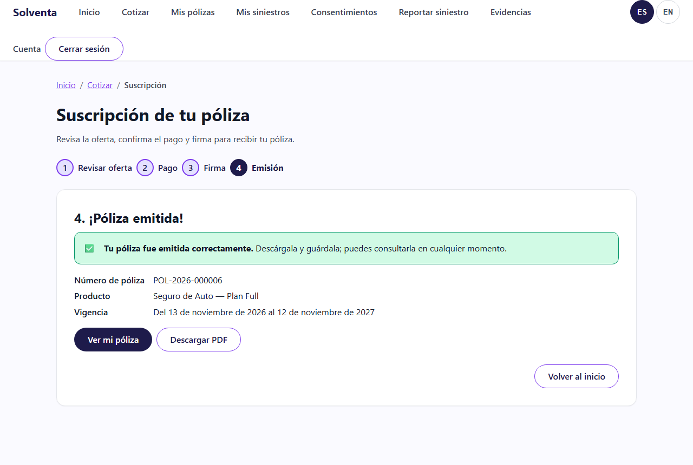
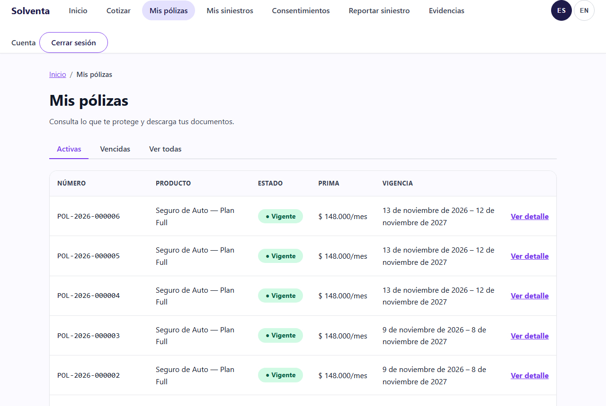
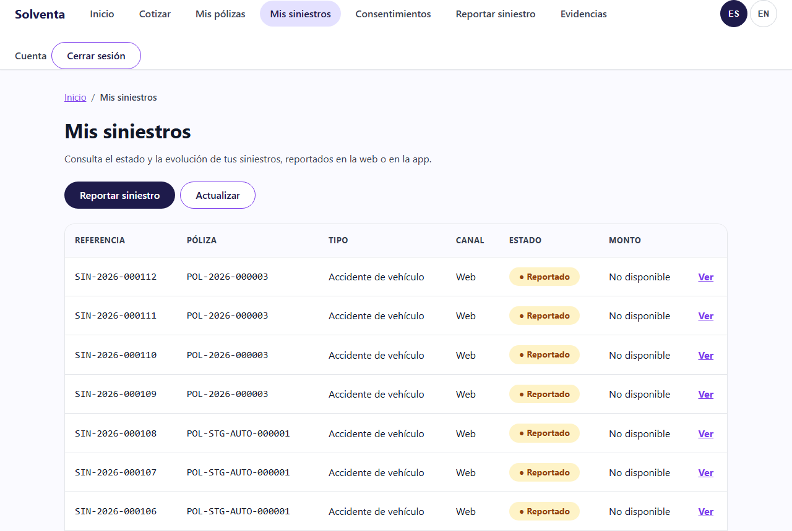

# Historias de Usuario Detalladas - Sprint 3 del Proyecto Final II

> **Proyecto:** Solventa · Aseguradora Digital de Finanzas Abiertas
> **Curso:** MISW4501 · Proyecto Final · Maestría en Ingeniería de Software · Universidad de los Andes
> **Grupo:** 13
> **Sprint:** 3 · semanas 5-7 del Proyecto Final II (2 - 22 nov 2026) · release `v0.3.0`

Sprint 3 cierra el recorrido del cliente después de cotizar: compra la póliza, la consulta en la
web y en la app, reporta un siniestro aunque no tenga señal, sigue su estado y recibe un aviso en
el teléfono cuando cambia. Además verifica sobre *staging* los requisitos de calidad que hasta
ahora solo se habían probado en los experimentos. Son **seis historias, 42 puntos**, más una
historia *stretch* que no suma.

Este documento sigue las convenciones del [Sprint 1](HistoriasUsuarioSprint1.md#convenciones) y la
forma de partir las historias del [Sprint 2](HistoriasUsuarioSprint2.md#cómo-se-parte-cada-historia).
Detalla el Sprint 3 tal como quedó en el tablero (GitHub Project 4).

> **Ubicación de este archivo:** `docs/HistoriasUsuarioSprint3.md`. Las rutas relativas están
> escritas desde `docs/`.

---

## Tabla de contenido

- [Objetivo del Sprint 3](#objetivo-del-sprint-3)
- [Backlog del Sprint 3](#backlog-del-sprint-3)
- [Historias](#historias)
  - [WEB-F03 · Comprar una póliza: aceptar, pagar y emitir](#web-f03--comprar-una-póliza-aceptar-pagar-y-emitir)
  - [WEB-F04 · Consultar mis pólizas en web y app](#web-f04--consultar-mis-pólizas-en-web-y-app)
  - [WEB-F06 · Seguir mi siniestro en web y app](#web-f06--seguir-mi-siniestro-en-web-y-app)
  - [MOB-F06 · Notificaciones push del siniestro](#mob-f06--notificaciones-push-del-siniestro)
  - [MOB-F05-02 · Reportar un siniestro sin conexión](#mob-f05-02--reportar-un-siniestro-sin-conexión)
  - [ARQ-05 · Verificación de calidad en staging](#arq-05--verificación-de-calidad-en-staging)
  - [MOB-F03 · Billetera y credencial sin conexión (stretch)](#mob-f03--billetera-y-credencial-sin-conexión-stretch)
- [Infraestructura del sprint](#infraestructura-del-sprint)
- [Trazabilidad a los requisitos de calidad](#trazabilidad-a-los-requisitos-de-calidad)
- [Asignación por integrante](#asignación-por-integrante)

---

## Objetivo del Sprint 3

**Objetivo del sprint:** que el cliente termine la compra con su póliza emitida y que el ciclo del
siniestro quede completo en los dos canales (reporte con o sin señal, seguimiento y aviso), con la
calidad medida sobre el producto desplegado y no supuesta.

### Guion del demo de cierre

1. El cliente cotiza en la web, acepta la oferta y paga. Pulsa dos veces **Pagar**: hay un solo
   cobro. Firma y recibe su póliza con número y PDF (WEB-F03).
2. Abre "Mis pólizas" en la web y en la app: la póliza recién emitida está en las dos, con sus
   coberturas, y el PDF se descarga (WEB-F04).
3. Pone el teléfono en modo avión y reporta un siniestro con una foto. La app lo guarda cifrado.
   Al volver la señal, lo envía sola, y queda un solo siniestro (MOB-F05-02).
4. Operaciones cambia el estado del siniestro a *requiere información*. El cliente lo ve al
   refrescar la web y la app, con el requerimiento pendiente, y responde adjuntando un documento
   (WEB-F06).
5. El teléfono recibe el aviso del cambio de estado; al tocarlo se abre el detalle de ese
   siniestro (MOB-F06).
6. Se muestran los reportes de k6 y de caos: la cotización cumple el presupuesto de latencia con
   el proveedor sano, degradado y caído, y la revocación del consentimiento se respeta en las dos
   réplicas (ARQ-05).

---

## Backlog del Sprint 3

| ID | Historia | Épica | Puntos | Depende de | Issue |
|---|---|---|---:|---|---|
| WEB-F03 | Comprar una póliza: aceptar, pagar y emitir | Venta | 13 | WEB-F01, WEB-F13 | [#138](https://github.com/JuanJoseRestrepo33/Proyecto_Grupo_13/issues/138) |
| WEB-F04 | Consultar mis pólizas en web y app | Venta | 8 | WEB-F03, WEB-F13 | [#186](https://github.com/JuanJoseRestrepo33/Proyecto_Grupo_13/issues/186) |
| WEB-F06 | Seguir mi siniestro en web y app | Siniestros | 8 | WEB-F05, MOB-F05 | [#195](https://github.com/JuanJoseRestrepo33/Proyecto_Grupo_13/issues/195) |
| MOB-F06 | Notificaciones push del siniestro | Siniestros | 5 | WEB-F06, WEB-F13 | [#204](https://github.com/JuanJoseRestrepo33/Proyecto_Grupo_13/issues/204) |
| MOB-F05-02 | Reportar un siniestro sin conexión | Siniestros | 3 | WEB-F05, MOB-F05 | [#211](https://github.com/JuanJoseRestrepo33/Proyecto_Grupo_13/issues/211) |
| ARQ-05 | Verificación de calidad en staging | Arquitectura y calidad | 5 | ARQ-02, WEB-F01, MOB-F02 | [#124](https://github.com/JuanJoseRestrepo33/Proyecto_Grupo_13/issues/124) |
| | **Total comprometido** | | **42** | | |
| MOB-F03 | Billetera y credencial sin conexión (*stretch*, no suma) | Venta | 13 | WEB-F04 | [#139](https://github.com/JuanJoseRestrepo33/Proyecto_Grupo_13/issues/139) |

> **ID:** el prefijo (`WEB`, `MOB`, `ARQ`) indica el origen del ID en el backlog, no el canal. Los
> canales los dice la tabla de partes de cada historia.

**Orden que imponen las dependencias:** WEB-F03 va primero, porque la póliza emitida es la que se
consulta en WEB-F04 y sobre la que se reportan siniestros. WEB-F06 publica el cambio de estado que
consume MOB-F06. MOB-F05-02 y ARQ-05 no dependen de las demás historias del sprint y avanzan en
paralelo.

**Cambios de alcance respecto al plan** (detallados en cada historia):

- WEB-F04 absorbe la consulta con conexión de MOB-F03 y sube de 5 a 8 puntos. El modo sin conexión
  queda en MOB-F03, como *stretch*.
- WEB-F06 absorbe el seguimiento en la app que estaba en MOB-F06, que queda solo con el push. El
  backend de seguimiento se hace una sola vez: entre las dos historias pasan de 16 a 13 puntos.
- ARQ-05 une la resiliencia ante Open Finance y la antigua "ARQ-04 Validación de calidad": misma
  herramienta (k6), mismo ambiente y mismo responsable.
- Comprar desde la app (MOB-F04) queda fuera del MVP por decisión del equipo. La póliza comprada en
  la web se ve en la app con WEB-F04.

---

## Historias

### WEB-F03 · Comprar una póliza: aceptar, pagar y emitir

**Como** cliente, **quiero** aceptar la oferta, pagar y firmar, **para** recibir mi póliza emitida
en minutos y no en días.

Todo el trabajo de esta historia queda en el Sprint 3, donde cierra. La rebanada del Sprint 1 (el
armazón del checkout contra los mocks, PR #219) ya existía; aquí se conecta al BFF real y se agregan
la firma, la emisión y el documento.

**Criterios de aceptación**

1. Dada una cotización vigente, cuando el cliente la acepta, entonces queda una suscripción en
   estado *aceptada* con las condiciones de la oferta. Una cotización vencida se rechaza y se ofrece
   recotizar.
2. Dado el pago contra la pasarela simulada, cuando el cliente reintenta la misma operación,
   entonces no se genera un segundo cobro y la interfaz comunica que el pago ya está en curso (P18).
3. Dado el checkout, cuando la pasarela responde aprobado, rechazado o pendiente, entonces la
   interfaz muestra cada estado con su siguiente paso. El botón de pago permanece ocupado mientras
   espera (P10).
4. Dado el pago aprobado, cuando el cliente firma electrónicamente (proveedor simulado), entonces la
   póliza queda emitida con su número y un documento descargable.
5. Dada una póliza emitida, cuando se consulta el log de auditoría, entonces están la aceptación, el
   pago, la firma y la emisión.

**Partes de la historia**

| Parte | Alcance | Responsable | Issue |
|---|---|---|---|
| Backend | Aceptación y pago contra la pasarela simulada | Sergio | #130 |
| Backend | Firma y emisión de la póliza con su documento | Sergio | #181 |
| Integración | Rutas de aceptación, pago y emisión en el router web | Sergio | #182 |
| Web | Checkout, estados de emisión y descarga del documento | Harold | #131 |
| Cloud | Documento de la póliza en un bucket privado, servido por el BFF; humo de las rutas | Juan | #183 |
| E2E web | Inicio de sesión → cotizar → aceptar → pagar → emitir → consultar la póliza | Harold | #184 |
| Documentación | Esta historia, la guía de usuario (compra) y el changelog de `bff-web` | Juan | #185 |
| Móvil | *N/A:* comprar desde la app es MOB-F04, fuera del MVP. La póliza emitida se ve en la app con WEB-F04 | - | - |

**Partición definida de antemano**

| | Alcance | Puntos |
|---|---|---:|
| **A** (se cierra) | Aceptar la oferta y pagar sin cobro doble (crit. 1, 2, 3) | 8 |
| **B** (se mueve) | Firmar y emitir la póliza con su documento (crit. 4, 5) | 5 |

**Notas técnicas**

- **Tres módulos nuevos en el núcleo**, cada uno con su esquema y su usuario en Cloud SQL:
  `suscripcion` (aceptación y firma), `pagos` (pasarela simulada) y `polizas` (emisión y documento).
  Se comunican por sus interfaces públicas, sin SQL entre ellos (ARQ-01).
- **La emisión es idempotente por suscripción.** Firmar otra vez una suscripción ya emitida responde
  200 con la misma póliza, el mismo número y sin otro documento. Si el proveedor de firma no
  responde, se responde 503 y no se emite nada: reintentar es seguro.
- **El documento no tiene URL firmada.** El PDF se guarda en el bucket privado
  `<proyecto>-solventa-documentos`, en `polizas/{id_suscripcion}/{numero}.pdf`, sin sobrescribir
  nunca un objeto. El núcleo lo lee y el BFF lo entrega en `GET /polizas/{numero}/documento` con la
  sesión del cliente. Así el enlace no se puede reenviar y el núcleo no necesita permiso para firmar
  URLs ([`devops.md`, sección 7.1](devops.md#71-bucket-de-documentos-de-póliza-web-f03)).
- **Sin permiso de borrar.** Si dos réplicas emiten a la vez la misma suscripción, el PDF de la que
  pierde queda huérfano en el bucket: borrarlo es limpieza y su falla solo deja un aviso en el log
  (#276).
- **Pasarela y firma simuladas, configurables en *staging*:** `PASARELA_TARJETA_CREDITO`,
  `PASARELA_PSE`, `PASARELA_PENDIENTE_SE_RESUELVE_EN`, `PASARELA_MODO` y `FIRMA_MODO`
  ([`devops.md`](devops.md#nombres-acordados-entre-componentes)).

**Patrones de interfaz.** P02 Migas de pan y barra de flujo · P10 Botón ocupado · P18 Idempotencia
comunicada.
**Capturas** (*staging*, 13 nov 2026), los cuatro pasos de la web contra el BFF y el núcleo
desplegados:
[`web-staging-suscripcion-revisar.png`](guia-de-usuario/img/web-staging-suscripcion-revisar.png) ·
[`web-staging-suscripcion-pago.png`](guia-de-usuario/img/web-staging-suscripcion-pago.png) ·
[`web-staging-suscripcion-pago-aprobado.png`](guia-de-usuario/img/web-staging-suscripcion-pago-aprobado.png) ·
[`web-staging-suscripcion-firma.png`](guia-de-usuario/img/web-staging-suscripcion-firma.png) ·
[`web-staging-suscripcion-emitida.png`](guia-de-usuario/img/web-staging-suscripcion-emitida.png)
(número de póliza, vigencia y descarga del PDF). *Pendiente:* las de la app.

**Favorece** RC-08 Trazabilidad y explicabilidad · **Puntos** 13 · **Responsables** Sergio
(backend, integración), Harold (web, E2E web), Juan (cloud, documentación) · **Depende de**
WEB-F01, WEB-F13

---

### WEB-F04 · Consultar mis pólizas en web y app

**Como** cliente, **quiero** consultar mis pólizas y coberturas desde la web o desde la app, **para**
saber en todo momento qué me protege.

Absorbe la consulta con conexión de MOB-F03; el modo sin conexión (billetera y credencial) queda en
MOB-F03, como *stretch*. Por eso sube de 5 a 8 puntos.

**Criterios de aceptación**

1. Dado un cliente con pólizas, cuando abre "Mis pólizas" en la web o en la app, entonces ve cada
   póliza con su producto, número, vigencia y estado, con insignia y texto (P12).
2. Dada una póliza emitida en la web (WEB-F03), cuando el cliente abre la app, entonces la ve sin
   hacer nada más.
3. Dado un cliente sin pólizas, cuando abre "Mis pólizas", entonces ve un estado vacío que lo lleva
   a cotizar.
4. Dada una póliza, cuando el cliente abre el detalle en cualquiera de los dos canales, entonces ve
   coberturas, deducibles y límites, y descarga el documento.

**Partes de la historia**

| Parte | Alcance | Responsable | Issue |
|---|---|---|---|
| Backend | API de consulta de pólizas y coberturas | Sergio | #187 |
| Integración | Rutas de pólizas en los dos routers del BFF | Sergio | #188 |
| Web | Lista y detalle de pólizas, con descarga del documento | Harold | #189 |
| Móvil | Lista y detalle de pólizas con conexión | Edwin | #190 |
| Cloud | Humo de las rutas de pólizas en *staging* | Juan | #191 |
| E2E web | Consultar la póliza recién emitida (encadenado al E2E de WEB-F03) | Harold | #192 |
| E2E móvil | La póliza emitida en la web aparece en la app | Edwin | #193 |
| Documentación | Esta historia, la guía de usuario (mis pólizas) y el changelog de los contratos | Juan | #194 |

**Partición definida de antemano**

| | Alcance | Puntos |
|---|---|---:|
| **A** (se cierra) | Lista y estado de pólizas en web y app (crit. 1, 2, 3) | 5 |
| **B** (se mueve) | Detalle de coberturas y documento en web y app (crit. 4) | 3 |

**Notas técnicas**

- **Una sola fuente para los dos canales.** Los dos routers del BFF leen las mismas rutas del
  núcleo (`/v1/clientes/{id}/polizas`), así que la póliza emitida en la web aparece en la app sin
  sincronizar nada (criterio 2).
- **Las pólizas de prueba de *staging* toman las condiciones del catálogo.** La semilla
  ([`polizas-staging.json`](../backend/semillas/polizas-staging.json)) usa plantillas con
  `id_cliente: "*"`: cualquier cliente recibe una de auto y una de viaje vigentes y una de hogar
  vencida, cada una con número propio. Su detalle trae coberturas, deducible y valor asegurado del
  catálogo de cotización, sin prima. No tienen documento: su descarga responde 404
  `documento_no_disponible`.
- **Humo en *staging*:** con la sesión de la cuenta de prueba, el detalle de una póliza vigente debe
  traer coberturas, y una póliza que no existe debe dar 404 y no 5xx
  ([`humo.py`](../scripts/humo.py)).

**Patrones de interfaz.** P03 Pestañas · P12 Insignias de estado con texto.
**Capturas** (*staging*, 13 nov 2026).
[`web-staging-polizas.png`](guia-de-usuario/img/web-staging-polizas.png) (pestaña *Activas*, la
recién emitida primero) ·
[`web-staging-poliza-detalle.png`](guia-de-usuario/img/web-staging-poliza-detalle.png) (coberturas,
deducible, límites y documento). *Pendiente:* las de la app (#190).

**Favorece** RC-06 Facilidad de integración · **Puntos** 8 · **Responsables** Sergio (backend,
integración), Harold (web, E2E web), Edwin (móvil, E2E móvil), Juan (cloud, documentación) ·
**Depende de** WEB-F03, WEB-F13

---

### WEB-F06 · Seguir mi siniestro en web y app

**Como** cliente asegurado, **quiero** consultar el estado y los requerimientos pendientes de mi
siniestro desde la web o desde la app, **para** conocer su progreso y responder a tiempo.

Absorbe el seguimiento en la app que antes estaba en MOB-F06; MOB-F06 queda solo con las
notificaciones push.

**Criterios de aceptación**

1. Dado un siniestro reportado, cuando el cliente abre "Mis siniestros" en la web o en la app,
   entonces ve su estado actual (reportado, en evaluación, requiere información, aprobado,
   rechazado, pagado) con texto, y es el mismo en los dos canales.
2. Dado un cambio de estado en el núcleo, cuando el cliente refresca cualquiera de los dos canales,
   entonces ve el estado nuevo.
3. Dado un cambio de estado, cuando ocurre, entonces queda en el log de auditoría y se publica el
   evento que consume MOB-F06.
4. Dado un siniestro, cuando el cliente abre el detalle, entonces ve el historial de eventos con su
   fecha.
5. Dado un requerimiento pendiente (por ejemplo, un documento), cuando el cliente lo ve, entonces
   sabe qué falta y puede responder adjuntando evidencia (MOB-F05).

**Partes de la historia**

| Parte | Alcance | Responsable | Issue |
|---|---|---|---|
| Backend | Seguimiento, eventos de cambio de estado y operación interna para cambiar el estado en *staging* y pruebas (sin interfaz) | Sergio | #196 |
| Integración | Rutas de seguimiento en los dos routers del BFF | Sergio | #197 |
| Web | Lista y detalle del siniestro con estado, historial y requerimientos | Harold | #198 |
| Móvil | Lista y detalle del siniestro en la app | Edwin | #199 |
| Cloud | Humo de las rutas de seguimiento en *staging* | Juan | #200 |
| E2E web | Reportar → cambiar el estado → ver el estado nuevo | Harold | #201 |
| E2E móvil | El cambio de estado se ve en la app | Edwin | #202 |
| Documentación | Esta historia, la guía de usuario (seguimiento) y el changelog de los contratos | Juan | #203 |

**Partición definida de antemano**

| | Alcance | Puntos |
|---|---|---:|
| **A** (se cierra) | Estado actual del caso en web y app, auditado (crit. 1, 2, 3) | 5 |
| **B** (se mueve) | Historial de eventos y requerimientos pendientes en web y app (crit. 4, 5) | 3 |

**Notas técnicas**

- **El cambio de estado no tiene interfaz para el cliente.** En *staging* y en las pruebas lo hace
  una operación interna del núcleo, `POST /v1/siniestros/{id}/estado`, que solo existe si está
  definido `SINIESTROS_TOKEN_INTERNO` (secreto `siniestros-token-interno`) y exige ese token en
  `X-Token-Interno`. Sin la variable, la ruta responde 404. El BFF no la expone.
- **El estado, su evento y los requerimientos van en una sola transacción** del esquema
  `siniestros`; la entrada en el log de auditoría se escribe antes. Un fallo nunca deja un estado
  cambiado sin su evento, ni un *requiere información* sin requerimientos. La evidencia y el
  requerimiento que atiende también se guardan juntos: de dos respuestas simultáneas, la segunda
  recibe 409 `requerimiento_ya_atendido` (#272).
- **Contrato:** `GET /siniestros/{id}` responde `SiniestroDetalle`, con el historial y los
  requerimientos. La evidencia acepta `id_requerimiento` para responder un requerimiento
  ([changelog](../contratos/bff-web/CHANGELOG.md)).

**Patrones de interfaz.** P11 Línea de tiempo de estado · P12 Insignias de estado con texto ·
P26 Ayuda en contexto.
**Capturas** (*staging*, 13 nov 2026).
[`web-staging-siniestros.png`](guia-de-usuario/img/web-staging-siniestros.png) (cada caso con su
canal y su estado) ·
[`web-staging-siniestro-detalle.png`](guia-de-usuario/img/web-staging-siniestro-detalle.png) (línea
de tiempo, resumen y siguiente paso). *Pendiente:* un caso con un requerimiento pendiente, porque
ninguno de *staging* tiene uno, y las de la app (#199).

**Favorece** RC-08 Trazabilidad y explicabilidad · **Puntos** 8 · **Responsables** Sergio
(backend, integración), Harold (web, E2E web), Edwin (móvil, E2E móvil), Juan (cloud,
documentación) · **Depende de** WEB-F05, MOB-F05

---

### MOB-F06 · Notificaciones push del siniestro

**Como** cliente asegurado, **quiero** recibir una notificación en el teléfono cuando cambia el
estado de mi siniestro, **para** enterarme sin tener que consultar.

El seguimiento en la app pasó a WEB-F06. Esta historia queda con el disparador, la recepción del
push y el enlace al detalle.

**Criterios de aceptación**

1. Dado un cambio de estado de un siniestro (WEB-F06), cuando ocurre, entonces el cliente recibe un
   push en la app (proveedor simulado).
2. Dado el push, cuando el cliente lo toca, entonces se abre el detalle de ese siniestro.
3. Dado un cliente que negó el permiso de notificaciones, cuando abre la app, entonces la app
   explica para qué sirve y el estado se sigue viendo en el seguimiento (P20).
4. Dado un dispositivo nuevo o una app reinstalada, cuando el cliente inicia sesión, entonces el
   dispositivo queda registrado para recibir push.

**Partes de la historia**

| Parte | Alcance | Responsable | Issue |
|---|---|---|---|
| Backend | Disparador de push por cambio de estado, con proveedor simulado | Sergio | #205 |
| Integración | Registro del dispositivo en el router móvil | Sergio | #206 |
| Móvil | Recepción del push, permiso con alternativa y enlace al detalle del siniestro | Edwin | #207 |
| Cloud | Proveedor push simulado en *staging*: base de notificaciones, `PUSH_MODO` y humo | Juan | #208 |
| E2E móvil | Cambio de estado → push recibido → abre el detalle | Edwin | #209 |
| Documentación | Esta historia, la guía de usuario (notificaciones) y el changelog de `bff-movil` | Juan | #210 |
| Web | *N/A:* el push es propio del móvil. En la web, el cambio de estado se ve en el seguimiento (WEB-F06) | - | - |

**Notas técnicas**

- **Cómo llega el push con el proveedor simulado.** No hay un servicio externo de push: el núcleo
  guarda cada notificación en el esquema `notificaciones`, y la app la lee con
  `GET /notificaciones` y la muestra como notificación local. Cada una trae en `datos` el
  `id_siniestro` que se abre al tocarla (criterio 2). Reemplazar el simulado por un proveedor real
  es cambiar el adaptador, no la app (RC-06).
- **Un push que no sale no tumba el cambio de estado.** Con `PUSH_MODO=caido` el proveedor rechaza
  todo envío, para probar que el siniestro cambia de estado igual. En *staging* queda
  `PUSH_MODO=sano`.
- **Registro idempotente.** `POST /dispositivos` responde 201 si el token es nuevo y 200 si ya
  estaba, así la app puede registrarlo en cada arranque (criterio 4). Al cerrar sesión lo da de
  baja con `DELETE /dispositivos/{id}`.
- **Las rutas existen solo en el router móvil.** El humo de *staging* comprueba que
  `/api/v1/web/notificaciones` responda 404.

**Patrones de interfaz.** P20 Permiso en contexto con alternativa.
**Capturas.** *Pendiente:* el aviso en el teléfono y el detalle que abre, con la parte móvil (#207).

**Favorece** RC-02 Escalabilidad · **Puntos** 5 · **Responsables** Sergio (backend, integración),
Edwin (móvil, E2E móvil), Juan (cloud, documentación) · **Depende de** WEB-F06, WEB-F13

---

### MOB-F05-02 · Reportar un siniestro sin conexión

**Como** cliente asegurado, **quiero** reportar mi siniestro aunque no tenga señal en el lugar,
**para** no perder el reporte ni la evidencia.

Sub-historia de MOB-F05 (su criterio 5 original). Es un escenario propio del móvil y reutiliza la
API idempotente de WEB-F05, ya desplegada.

**Criterios de aceptación**

1. Dado el teléfono sin conexión, cuando el cliente envía el reporte, entonces la app lo guarda como
   borrador en el dispositivo y le indica que se enviará al recuperar la conexión.
2. Dada la conexión recuperada, cuando la app reintenta, entonces envía el reporte sin que el
   cliente haga nada, y un reenvío no crea un segundo siniestro, porque usa la misma clave de
   idempotencia de WEB-F05.
3. Dado un borrador guardado, cuando se inspecciona el almacenamiento del dispositivo, entonces está
   cifrado en reposo, porque puede contener fotos de terceros y ubicación.

**Partes de la historia**

| Parte | Alcance | Responsable | Issue |
|---|---|---|---|
| Móvil | Borrador cifrado en el dispositivo y envío al reconectar, con la misma clave de idempotencia | Edwin | #212 |
| E2E móvil | Modo avión → enviar → reconectar → un solo siniestro | Edwin | #213 |
| Documentación | Esta historia y la guía de usuario (reporte sin conexión) | Juan | #214 |
| Backend · Integración · Cloud | *N/A:* reutiliza la API idempotente de WEB-F05, ya desplegada; no hay ruta ni infraestructura nueva | - | - |
| Web | *N/A:* escenario propio del móvil: la web no opera sin conexión | - | - |

**Notas técnicas** (PR #273; detalle en
[`feature/siniestros`](../mobile/android/feature/siniestros/README.md#reporte-sin-conexión-mob-f05-02))

- **Todo envío pasa por un borrador cifrado**, con o sin señal: el reporte y su evidencia se
  guardan primero en el teléfono, cifrados con una llave del Android Keystore, y después se envían.
  Si la app muere a mitad de envío, el borrador sigue ahí.
- **La clave de idempotencia nace una vez por reporte** y viaja en el borrador. Cada reintento
  manda la misma clave y los mismos datos, y el BFF responde con el mismo siniestro (criterio 2).
  Si un envío anterior pudo quedar registrado sin respuesta, la app lo concilia antes de crear otro.
- **El borrador es de la cuenta.** Al cerrar sesión con reportes pendientes, la app avisa que
  seguirán guardados y cifrados y que se enviarán al volver a ingresar; otra cuenta no puede verlos.
- **Para reportar sin señal la app necesita haber consultado las pólizas una vez** en ese teléfono.
  Sin conexión no puede confirmar la vigencia: la revisa el núcleo al recibir el reporte.

**Capturas.** *Pendiente:* el reporte guardado sin conexión y la tarjeta de envío en Inicio, en la
app contra *staging*.

**Favorece** RC-03 Disponibilidad, RC-04 Seguridad · **Puntos** 3 · **Responsables** Edwin (móvil,
E2E móvil), Juan (documentación) · **Depende de** WEB-F05, MOB-F05

---

### ARQ-05 · Verificación de calidad en staging

**Como** equipo, **queremos** verificar sobre el producto integrado y desplegado la latencia, la
resiliencia, la protección de datos y la trazabilidad, **para** sustentar los requisitos de calidad
con evidencia y no con supuestos.

ARQ-02 (PR #117) ya dejó el circuit breaker, el presupuesto de 120 ms y la caché de perfiles. Esta
historia los mide en *staging*.

**Criterios de aceptación**

1. Dado el sistema desplegado en *staging*, cuando se ejecuta la prueba de carga de cotización a
   1.000 cotizaciones por minuto durante 5 minutos (perfil de EXP-01), entonces la latencia de
   extremo a extremo cumple p95 ≤ 250 ms y p99 ≤ 500 ms con el proveedor sano, degradado y caído
   (RC-01).
2. Dado el proveedor caído, cuando se cotiza, entonces ninguna solicitud termina en error del
   servidor: la tasa de fallas es menor a 0,1 % y cada oferta indica si se calculó con el perfil en
   caché o con la tarifa estándar (RC-03).
3. Dadas dos réplicas detrás del balanceador, cuando un cliente revoca su consentimiento en una de
   ellas, entonces ninguna de las dos vuelve a usar su perfil desde la caché (RC-04).
4. Dado el circuito abierto, cuando el proveedor vuelve a responder, entonces el circuito se cierra
   solo, sin reiniciar el núcleo, y `/salud` pasa de `degradado` a `ok`.
5. Dada una cotización calculada sin el perfil en vivo, cuando se consulta después, entonces queda
   registrado que fue degradada, y el log de auditoría guarda la base usada
   (`open_finance_en_cache` o `estandar`).
6. Dado un registro del log de auditoría alterado en *staging*, cuando se verifica la cadena de
   hash, entonces la verificación lo detecta (RC-08).
7. Dado el reporte de k6, cuando se revisa, entonces incluye el costo medido de la consulta del
   estado del consentimiento en el camino de la cotización y confirma que cabe en p95 ≤ 250 ms.

**Partes de la historia**

| Parte | Alcance | Responsable | Issue |
|---|---|---|---|
| Backend | Persistencia del consentimiento en Cloud SQL y verificación de su estado vigente antes de usar la caché de perfil; umbrales del circuito como configuración | Sergio | #215 |
| Cloud | Réplicas del núcleo en Cloud Run (mínimo 2), variables de los umbrales y job manual de k6 contra *staging* | Juan | #136 |
| Pruebas de carga y caos | k6 con el proveedor sano, degradado y caído; revocación entre réplicas; caos; verificación de la cadena de auditoría. Puntos de prueba: Bogotá y Cali | Juan | #216 |
| Documentación | ADR que reemplaza D-04 de EXP-04 e informe de calidad con los reportes de k6 y caos | Juan | #217 |
| Integración · Web · Móvil | *N/A:* historia de arquitectura sin interfaz y sin cambios de contrato | - | - |

**Notas técnicas**

- **Cambio de decisión (reemplaza D-04 de EXP-04):** D-04 invalidaba la caché de perfiles con el
  evento de revocación. Ahora, antes de usar un perfil de la caché local de cada réplica, el núcleo
  verifica en Cloud SQL que el consentimiento siga vigente (#275). Así RC-04 se cumple entre réplicas
  sin Redis. El costo de esa consulta adicional se mide con k6 (criterio 7), no se supone.
- **Sin Redis por defecto.** Memorystore solo se agrega si k6 muestra que no se cumple
  p95 ≤ 250 ms.
- **Umbrales del circuito como configuración:** `PERFILAMIENTO_CIRCUITO_UMBRAL` (10 %),
  `PERFILAMIENTO_CIRCUITO_VENTANA_S` (30 s) y `PERFILAMIENTO_CIRCUITO_MINIMO_LLAMADAS` (5).
- **Bloqueo para las dos réplicas:** las cuentas de identidad (WEB-F13) todavía viven en memoria
  (`RepositorioDeCuentasEnMemoria`). Con dos réplicas, una cuenta registrada en una no existe en la
  otra, así que el inicio de sesión fallaría al azar. Las réplicas (#136) esperan a que identidad
  persista en Cloud SQL, como ya lo hacen el consentimiento y los demás módulos.
- El guion de carga reutiliza `solventa-experiments/exp01-resiliencia/carga.js` apuntando a
  *staging*.

**Favorece** RC-01 Latencia, RC-03 Disponibilidad, RC-04 Seguridad, RC-08 Trazabilidad ·
**Puntos** 5 · **Responsables** Sergio (backend), Juan (cloud, pruebas de carga y caos,
documentación) · **Depende de** ARQ-02, WEB-F01, MOB-F02

---

### MOB-F03 · Billetera y credencial sin conexión (stretch)

**Como** cliente, **quiero** ver mis pólizas y mi credencial en el móvil aunque no tenga conexión,
**para** demostrar mi cobertura en el momento en que la necesito.

**Stretch del Sprint 3: no comprometida y no suma a los 42 puntos.** La consulta con conexión pasó a
WEB-F04; aquí queda solo el modo sin conexión. Se compromete si el equipo cierra lo demás con margen;
si no, queda como avance y se re-estima.

**Criterios de aceptación**

1. Dadas las pólizas del cliente sincronizadas, cuando abre la billetera sin conexión, entonces las
   ve con la fecha y hora de la última sincronización.
2. Dada la conexión recuperada, cuando el cliente vuelve a la billetera, entonces se sincroniza sola.
3. Dada una póliza vigente, cuando el cliente abre su credencial sin conexión, entonces la ve
   completa y verificable.

| Parte | Alcance | Responsable | Issue |
|---|---|---|---|
| Móvil | Billetera sin conexión, avance | Edwin | #134 |

**Favorece** RC-03 Disponibilidad · **Puntos** 13 · **Responsable** Edwin · **Depende de** WEB-F04

---

## Infraestructura del sprint

Lo que el sprint agrega a *staging*. Todo lo crea *Aprovisionar ambiente*, que omite lo que ya
existe ([`devops.md`](devops.md#aprovisionar-y-destruir-el-ambiente)):

| Recurso | Para qué | Historia | PR |
|---|---|---|---|
| Usuarios y esquemas `suscripcion`, `pagos` y `polizas` en Cloud SQL, con sus secretos `*-database-url` | Suscripción, pago y póliza emitida persisten entre revisiones | WEB-F03 | #277 |
| Bucket `<proyecto>-solventa-documentos`: privado, sin ciclo de vida y sin permiso de borrar | PDF de las pólizas emitidas | WEB-F03 | #277 |
| Secreto `siniestros-token-interno` | Operación interna de cambio de estado, solo en *staging* | WEB-F06 | #277 |
| Usuario y esquema `notificaciones`, y `PUSH_MODO=sano` | Dispositivos y notificaciones del proveedor push simulado | MOB-F06 | #277, #279 |
| Usuario y esquema `consentimiento` | Consentimiento persistente: requisito para tener varias réplicas | ARQ-05 | #277 |
| Filas nuevas del humo | Pólizas, compra, seguimiento y push: rutas protegidas en 401, lecturas con sesión y 404 en lo inexistente | WEB-F03, WEB-F04, WEB-F06, MOB-F06 | #277, #279 |

La topología no cambia: tres servicios de Cloud Run (núcleo, BFF y web), una instancia de Cloud SQL
con un esquema por módulo, Secret Manager, Cloud Storage y Artifact Registry. GKE, Memorystore,
Pub/Sub y la región de respaldo de los experimentos del PRY1 siguen fuera de alcance (ARQ-01).

---

## Trazabilidad a los requisitos de calidad

| Requisito de calidad | Historias del Sprint 3 | Qué queda para después |
|---|---|---|
| **RC-01 Latencia** - cotización p95 ≤ 250 ms | ARQ-05 (criterios 1 y 7: medido en *staging* con k6, incluido el costo de verificar el consentimiento) | Memorystore, solo si k6 muestra que no se cumple |
| **RC-02 Escalabilidad de eventos** | MOB-F06 (el cambio de estado no depende de que el push salga) | Siniestros paramétricos con cola y consumidores |
| **RC-03 Disponibilidad** | ARQ-05 (criterios 2 y 4: sin errores con el proveedor caído, el circuito se cierra solo), MOB-F05-02 (el reporte no se pierde sin señal) | Redundancia multi-zona y región de respaldo |
| **RC-04 Seguridad y privacidad** | ARQ-05 (criterio 3: la revocación se respeta en las dos réplicas), MOB-F05-02 (borrador cifrado), WEB-F03 (documento en bucket privado, sin URL reenviable) | mTLS entre servicios, API Gateway |
| **RC-06 Facilidad de integración** | WEB-F04 (las mismas rutas del núcleo para los dos canales), MOB-F06 (proveedor push detrás de un adaptador) | Proveedor de push real |
| **RC-08 Trazabilidad y explicabilidad** | WEB-F03 (aceptación, pago, firma y emisión en el log), WEB-F06 (cada cambio de estado auditado), ARQ-05 (criterios 5 y 6: base de la oferta degradada y cadena de hash verificada) | - |

---

## Asignación por integrante

| Persona | Rol en el sprint | Partes |
|---|---|---|
| **Sergio** | Backend e integración | Backend e Integración de WEB-F03, WEB-F04, WEB-F06 y MOB-F06, y Backend de ARQ-05 |
| **Harold** | Web | Web y E2E web de WEB-F03, WEB-F04 y WEB-F06 |
| **Edwin** | Móvil | Móvil y E2E móvil de WEB-F04, WEB-F06, MOB-F06 y MOB-F05-02, y el *stretch* MOB-F03 |
| **Juan** | Cloud, calidad y documentación | Cloud y Documentación de las seis historias, y Pruebas de carga y caos de ARQ-05 |

**El riesgo de este sprint** es ARQ-05: las pruebas de carga y caos necesitan dos réplicas del
núcleo, y las réplicas esperan a que identidad persista. Si en el punto de control del sprint
identidad sigue en memoria, k6 corre con una réplica (criterios 1, 2, 4, 5, 6 y 7) y la revocación
entre réplicas (criterio 3) queda como deuda explícita.

---

**Proyecto Final** · MISW4501 · Maestría en Ingeniería de Software · Universidad de los Andes · Grupo 13
