# Guía de usuario · Solventa

Solventa es una aseguradora digital: puedes cotizar, comprar y administrar tus seguros, y reportar siniestros, desde el navegador o desde el celular.

| Canal | Para qué sirve |
|---|---|
| **Web** | Gestión completa: cotizar y comprar, consentimiento de datos, pólizas, siniestros. También el tablero de **Operaciones** y el portal de **Socios de distribución**. |
| **App móvil** | Autoservicio: registro con biometría, billetera de pólizas (también sin conexión), reporte de siniestros con fotos, asistencia en sitio, escaneo de documentos y notificaciones. |

> Esta guía describe el **prototipo navegable**. Los pagos, la verificación de identidad y las consultas a tu banco son simulados: no se cobra dinero ni se envían datos reales.

## Contenido

- [Antes de empezar](#antes-de-empezar)
- **Web · clientes:** [Iniciar sesión](#1-iniciar-sesión) · [Inicio](#2-inicio) · [Consentimiento de datos](#3-consentimiento-de-datos-financieros) · [Cotizar](#4-cotizar-un-seguro) · [Comprar](#5-comprar-y-recibir-tu-póliza) · [Mis pólizas](#6-consultar-tus-pólizas) · [Modificar, renovar o cancelar](#7-modificar-renovar-o-cancelar-una-póliza) · [Reportar siniestro](#8-reportar-un-siniestro) · [Seguimiento](#9-seguir-tus-siniestros) · [Vida hipotecario](#10-oferta-de-vida-hipotecario) · [Cuenta y ayuda](#11-perfil-configuración-y-ayuda)
- **Web · equipos internos:** [Tablero operacional](#12-tablero-operacional) · [Portal de socios](#13-portal-de-socios-de-distribución)
- **App móvil:** [Crear cuenta](#14-crear-tu-cuenta) · [Ingresar](#15-ingresar-a-la-app) · [Consentimiento](#16-consentimiento-de-datos-financieros-en-la-app) · [Cotizar y comprar](#17-cotizar-y-comprar-desde-el-celular) · [Billetera](#18-billetera-de-pólizas-y-modo-sin-conexión) · [Siniestros](#19-siniestros-desde-el-celular) · [Asistencia](#20-asistencia-en-sitio) · [Escanear](#21-escanear-documentos) · [Notificaciones](#22-notificaciones)
- [Mensajes que puedes ver y qué hacer](#mensajes-que-puedes-ver-y-qué-hacer) · [Accesibilidad e idioma](#accesibilidad-e-idioma)

---

## Antes de empezar

**Abrir la demo.** No necesitas instalar nada:

- Web: [https://juanjoserestrepo33.github.io/Proyecto_Grupo_13/web/login.html](https://juanjoserestrepo33.github.io/Proyecto_Grupo_13/web/login.html)
- Móvil: [https://juanjoserestrepo33.github.io/Proyecto_Grupo_13/mobile-docs/login.html](https://juanjoserestrepo33.github.io/Proyecto_Grupo_13/mobile-docs/login.html) (se muestra dentro de un marco de celular)

También puedes abrirla en tu equipo: desde la carpeta del proyecto ejecuta `python3 -m http.server 8765` y abre `http://localhost:8765/web/login.html` o `http://localhost:8765/mobile-docs/login.html`.

**Datos de prueba.** El inicio de sesión ya trae un usuario de ejemplo: `juan.rodriguez@correo.com` / `demo1234`.

**Ambiente de pruebas (*staging*).** Las secciones 1, 3, 4 y 8 describen la web real, desplegada
en [https://solventa-web-6y7n6dblla-ue.a.run.app](https://solventa-web-6y7n6dblla-ue.a.run.app), y
las secciones 14, 15 y 16, la app real. Ahí entras con una cuenta creada en la app (sección 14); no
hay usuario de ejemplo. La verificación de identidad y las consultas a tu banco siguen siendo
simuladas.

**Botones “Demo”.** Algunas pantallas tienen casillas marcadas con la etiqueta **Demo**. Sirven para ver qué pasa en situaciones poco frecuentes (el banco no responde, un pago es rechazado, no hay internet). No existen en el producto real.

**Empezar de cero.** Lo que haces en la demo (pólizas compradas, consentimientos, reclamos) se conserva mientras la pestaña esté abierta. Cierra la pestaña para volver al estado inicial.

---

# Web · clientes

## 1. Iniciar sesión

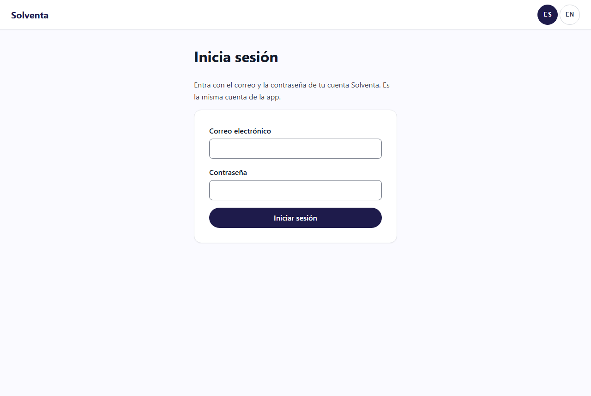

Entras con **la misma cuenta de la app**: si te registraste en el celular (sección 14), no
necesitas crear otra.

1. Escribe tu **correo electrónico** y tu **contraseña**.
2. Pulsa **Iniciar sesión**. Mientras validamos tus datos, el botón dice *Iniciando sesión…*.
3. Entras a tu inicio. Si habías abierto una página que pide sesión, vuelves a ella.

Si el correo o la contraseña no son correctos, verás un único mensaje: por seguridad no te decimos
cuál de los dos falló ni si el correo tiene cuenta.

**Tu sesión dura una hora.** Al vencer, la próxima vez que hagas algo te pedimos iniciar sesión de
nuevo (*Tu sesión venció…*) y no pierdes la página en la que estabas. Para salir, pulsa **Cerrar
sesión** en la barra superior.

> En el prototipo navegable, **Ingresar como (demo)** permite entrar como Operaciones o Socio de
> distribución (secciones 12 y 13). En *staging* solo hay cuentas de cliente.

## 2. Inicio

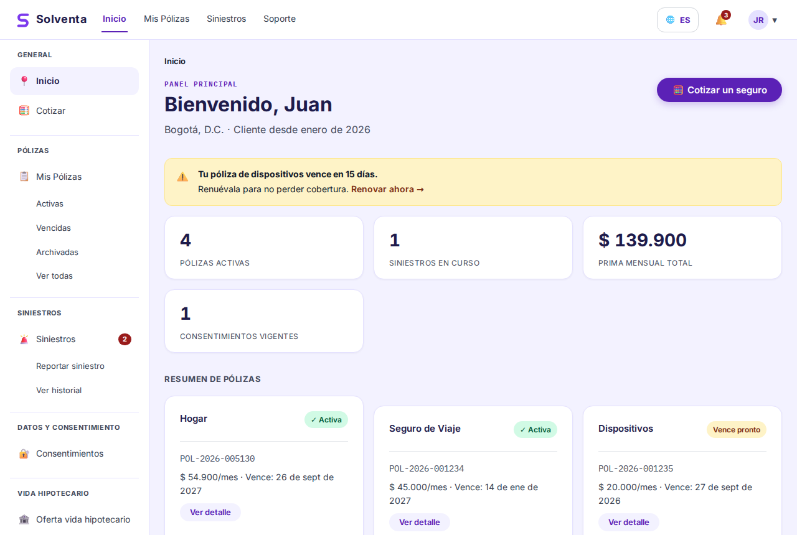

Muestra tus pólizas activas, siniestros en curso, prima mensual total y consentimientos vigentes. Si una póliza está por vencer, verás un aviso con el enlace **Renovar ahora**. La campana 🔔 de la barra superior reúne tus notificaciones.

El menú de la izquierda agrupa todo por tema: Cotizar, Pólizas, Siniestros, Consentimientos, Vida hipotecario y Cuenta. En pantallas pequeñas se abre con el botón ☰.

## 3. Consentimiento de datos financieros

Solventa puede ofrecerte un precio más justo si autorizas el uso de tus datos financieros (comportamiento de pago, endeudamiento y estabilidad de ingresos) a través de **Open Finance**. Tú decides.

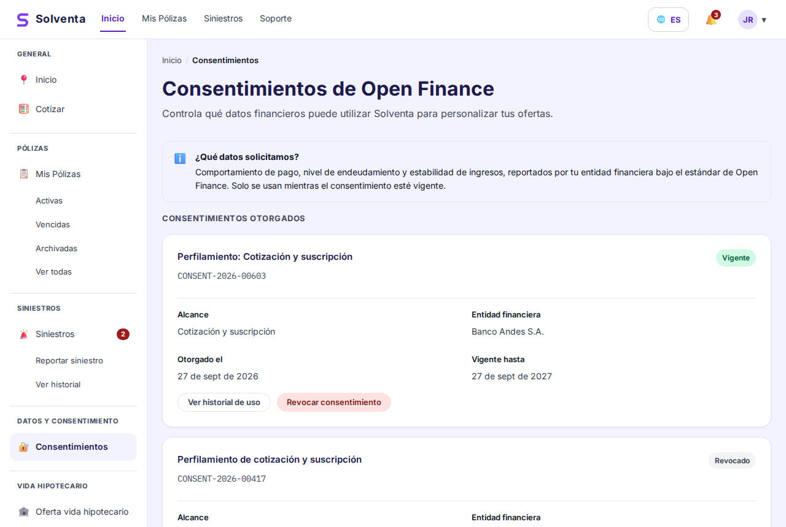

**Otorgar un consentimiento**
1. Ve a **Consentimientos**.
2. En *Otorgar un nuevo consentimiento*, elige tu entidad financiera y el alcance.
3. Marca la casilla de autorización y pulsa **Otorgar consentimiento**. Queda vigente por 12 meses.

**Ver cómo se han usado tus datos:** pulsa **Ver historial de uso** en el consentimiento.

**Revocar:** pulsa **Revocar consentimiento** y confirma. Dejamos de usar tus datos en menos de 5 minutos. Tus pólizas vigentes no se afectan; las nuevas cotizaciones usarán el precio estándar.

## 4. Cotizar un seguro

1. Pulsa **Cotizar** en el menú.
2. **Producto:** elige qué quieres asegurar (Auto, Hogar, Viaje o Dispositivos). Cada opción muestra su precio *desde*.
3. **Tus datos:** escribe tu fecha de nacimiento y tu ciudad. El valor asegurado es opcional: si lo dejas vacío, usamos el del plan. No puedes continuar con un dato inválido; cada campo te dice qué corregir (por ejemplo, la edad para cotizar va de 18 a 100 años).
4. **Open Finance:** deja encendido **Usar mis datos financieros (Open Finance)** para un precio personalizado. Si no tienes un consentimiento vigente para cotización, verás *Cotizaremos con precio estándar* y el enlace **Otorgar consentimiento**. Pulsa **Ver mi oferta**.
5. **Tu oferta:** revisa la prima mensual, cuánto ahorras frente al precio estándar, el valor asegurado, el deducible y las coberturas.

- **¿Por qué este precio?** muestra cada factor que movió tu prima, cuánto la movió y con qué versión de la regla se calculó.
- **Precio estándar no es un error.** Si no autorizaste tus datos o elegiste cotizar sin ellos, la oferta usa el precio estándar y te dice por qué.
- **Si tu banco tarda en responder,** cotizamos con tu perfil financiero guardado y te lo indicamos con un aviso amarillo. El precio es igual de válido.
- La oferta es válida por **5 minutos** (verás la cuenta regresiva). Si vence, pulsa **Recotizar**: usamos los mismos datos.

Cuando estés conforme, pulsa **Aceptar oferta**. Para empezar otra, pulsa **Cotizar otro producto**.

## 5. Comprar y recibir tu póliza

Desde tu oferta, pulsa **Aceptar oferta**. Arriba verás las migas de pan (*Inicio / Cotizar / Suscripción*) para saber dónde estás y volver al cotizador cuando quieras. La suscripción tiene cuatro pasos:

1. **Revisar oferta.** Confirma el producto, la prima, las coberturas y cuánto tiempo le queda a la oferta. Pulsa **Aceptar y continuar al pago**. Si la oferta venció, pulsa **Volver a cotizar**. Verás la *Decisión de suscripción*: normalmente **Aprobada automáticamente**. Si dice **En revisión asistida**, un analista revisará tu caso (máximo 4 horas) y te avisaremos.

   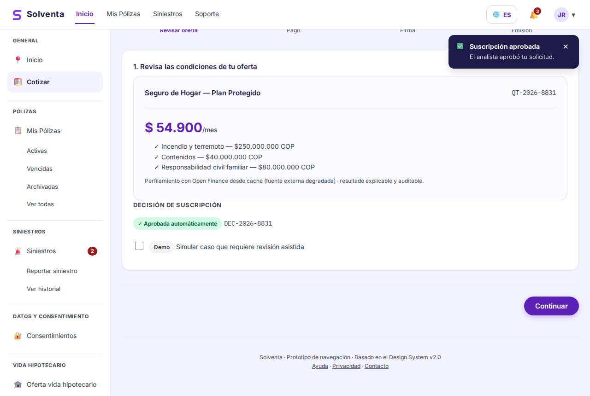

2. **Pago.** Elige **Tarjeta de crédito** o **PSE** y pulsa **Pagar**. Los datos de tu tarjeta o de tu cuenta los escribes en la pasarela de pagos; Solventa no los guarda. Mientras se procesa, el botón dice *Procesando pago…*: no cierres la ventana ni pulses de nuevo.
   - **Pago aprobado:** verás la referencia de la transacción y seguirás con la firma.
   - **Pago rechazado:** te confirmamos que **no se hizo ningún cobro**. Pulsa **Intentar de nuevo**.
   - **Pago pendiente** (común con PSE): tu banco aún no confirma. No pagues otra vez; pulsa **Consultar estado del pago** en unos minutos.
   - Si se cae la conexión o pulsas dos veces, **nunca se te cobra dos veces**: al reintentar, te mostramos el pago que ya se había hecho.
3. **Firma.** Pulsa **Firmar electrónicamente**, lee el resumen, acepta los términos y pulsa **Aceptar y firmar**.
4. **Emisión.** Recibes el número de póliza, la vigencia y el documento en PDF.

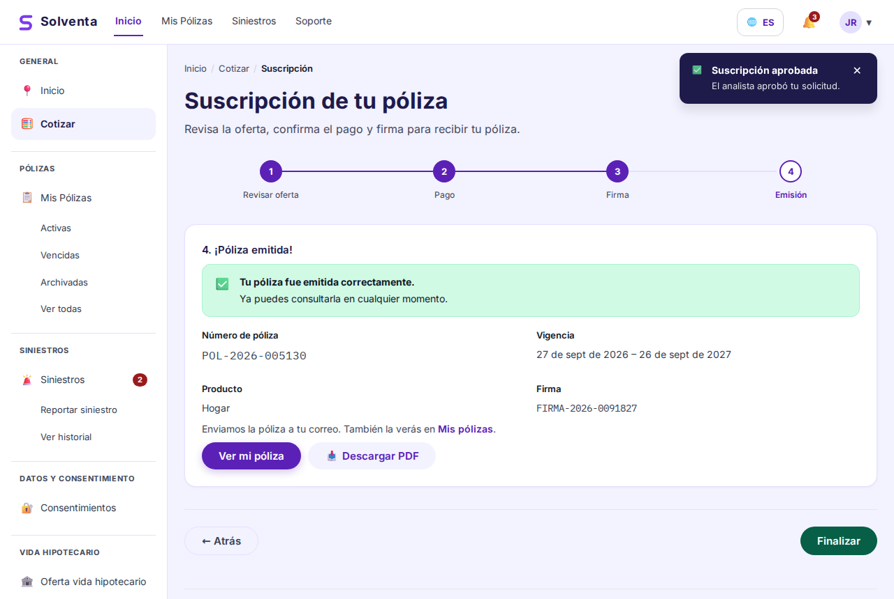

Tu nueva póliza aparece de inmediato en **Mis pólizas** y en el inicio, marcada como *Nueva*.

## 6. Consultar tus pólizas

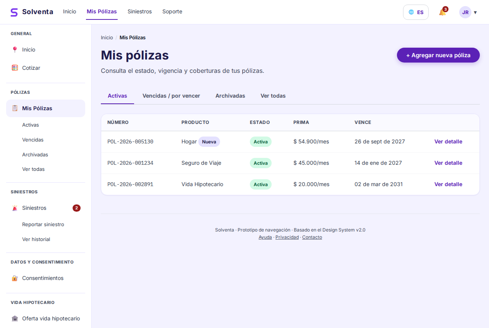

Las pestañas separan pólizas **Activas**, **Vencidas / por vencer** y **Archivadas**. **Ver detalle** muestra vigencia, coberturas, forma de pago, historial de pagos y el PDF.

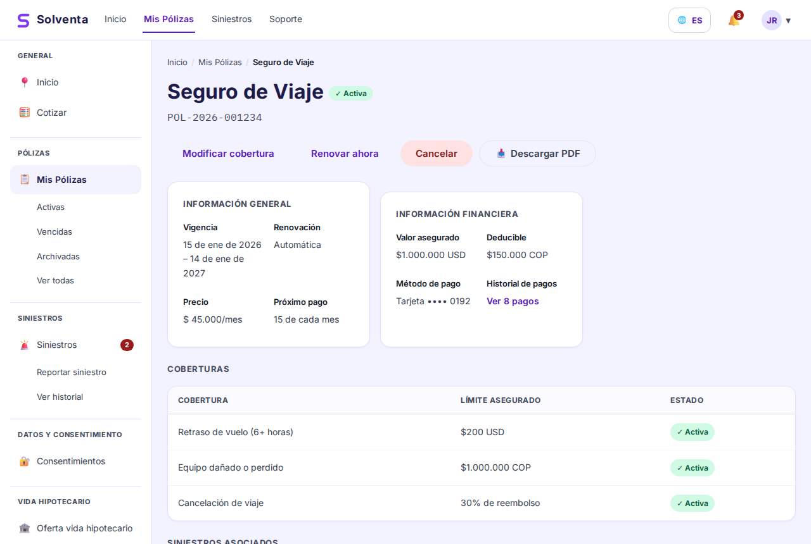

## 7. Modificar, renovar o cancelar una póliza

Desde el detalle de la póliza:

- **Modificar cobertura:** marca o desmarca coberturas y adicionales; el nuevo precio se calcula mientras eliges. Debe quedar al menos una cobertura.
- **Renovar:** revisa la nueva vigencia y la nueva prima y pulsa **Aceptar renovación**.
- **Cancelar:** marca la casilla *Entiendo las consecuencias…* y confirma en la ventana. Esta acción no se puede deshacer; la póliza queda como *Cancelada* y ya no permite cambios.

## 8. Reportar un siniestro

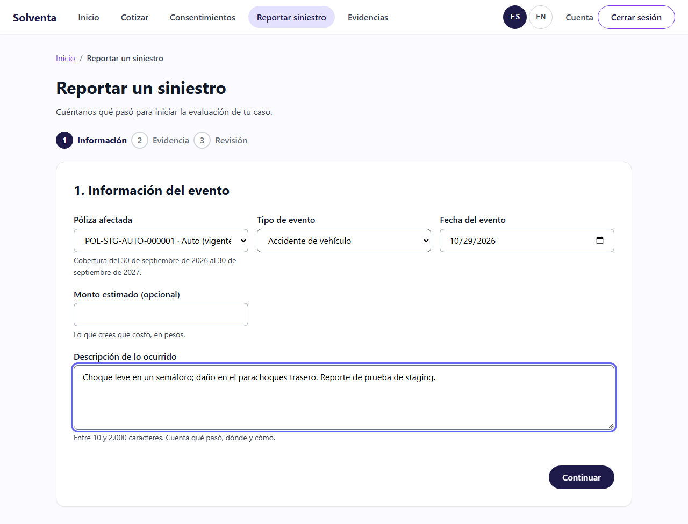

Pulsa **Reportar siniestro** en el menú. Arriba ves en qué paso vas (*paso 1 de 3*).

1. **Información del evento.** Elige la **póliza afectada** (cada una dice si está vigente o
   vencida, y su periodo de cobertura), el **tipo de evento**, la **fecha** y una **descripción** de
   lo ocurrido (entre 10 y 2.000 caracteres). El **monto estimado** es opcional. Si falta un dato, el
   campo te dice qué corregir y no puedes continuar.
   - La fecha no puede ser posterior a hoy.
   - Con una **póliza vencida** puedes reportar un evento que ocurrió mientras estaba vigente. Si
     ocurrió después, te explicamos por qué no está cubierto y no se registra nada.
2. **Evidencias** (opcional). Adjunta fotos, videos o documentos; ver *Adjuntar evidencia* abajo.
   Puedes enviar el reporte sin evidencias y agregarlas después.
3. **Revisa tu reporte.** Comprueba el resumen y pulsa **Enviar reporte**. Mientras se envía, el
   botón dice *Enviando reporte…*: no hace falta pulsarlo de nuevo.

Verás **Reporte enviado** con el **número de referencia**, el estado *Reportado* y el siguiente paso
de tu caso. **La referencia es la misma en la web y en la app**: el siniestro se ve en los dos
canales.

**Nunca queda un reporte repetido.** Si pulsas dos veces o se cae la conexión al enviar, vuelve a
intentarlo: si el reporte ya había llegado, verás el mismo número de referencia.

### Adjuntar evidencia

Se admiten **JPEG, PNG, HEIC, MP4 y PDF, hasta 10 MB por archivo**.

- **En el reporte:** en el paso 2, pulsa **Adjuntar fotos, videos o documentos** y elige uno o
  varios archivos. Antes de enviar ves la lista y puedes **Quitar** cualquiera. Un archivo de otro
  formato, vacío o de más de 10 MB se rechaza en ese momento, con el motivo.

  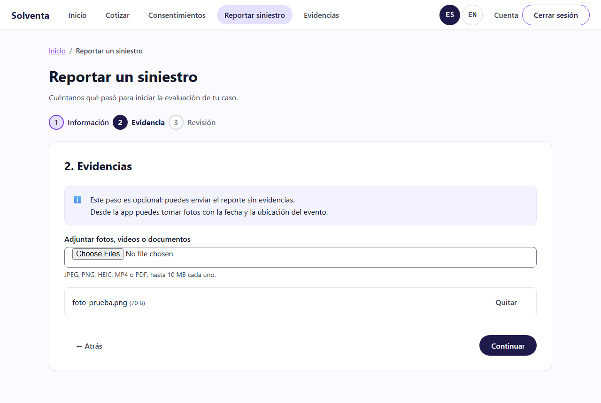
- **Después del reporte:** desde la confirmación pulsa **Agregar evidencia**, o en el menú
  **Evidencias** elige el siniestro. Ves las evidencias que ya tiene, desde qué canal se adjuntó
  cada una (la web o la app) y puedes **Descargar** cualquiera.

  

Las evidencias son privadas: solo las ves tú, con tu sesión. Una vez adjunta, una evidencia no se
borra ni se reemplaza.

## 9. Seguir tus siniestros

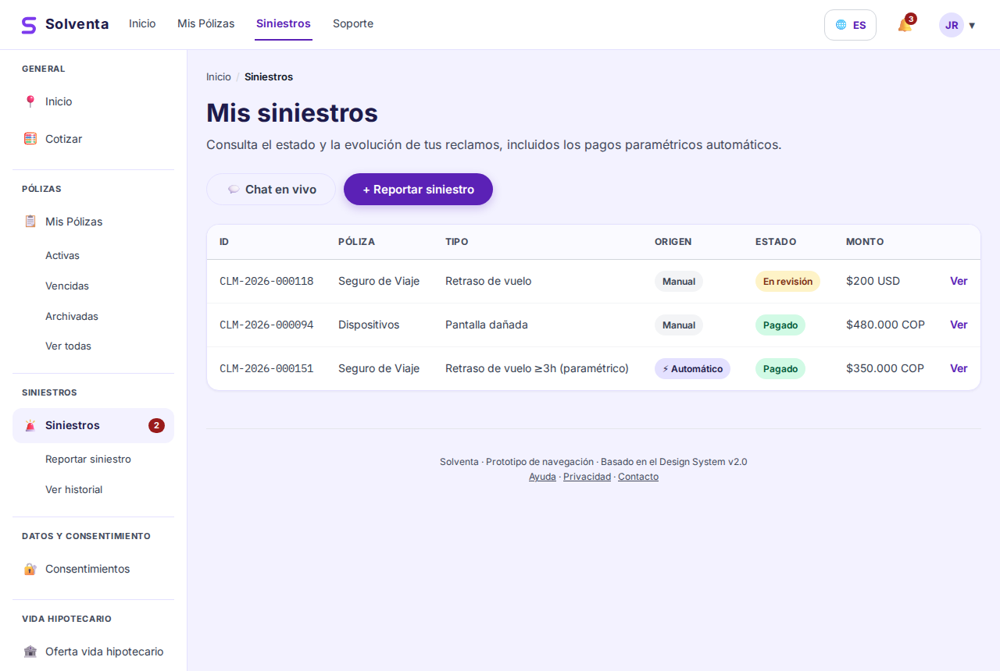

La lista muestra cada reclamo con su origen, estado y monto. **Ver** abre la línea de tiempo con cada etapa (recibido, validado, en evaluación, decisión y pago).

- **⚡ Automático (paramétrico):** algunos seguros pagan solos cuando ocurre un evento verificable, por ejemplo un vuelo con 3 horas o más de retraso. No tienes que reclamar; verás el evento detectado y el pago.
- **💬 Chat en vivo:** habla con un asesor sobre tu caso.

## 10. Oferta de vida hipotecario

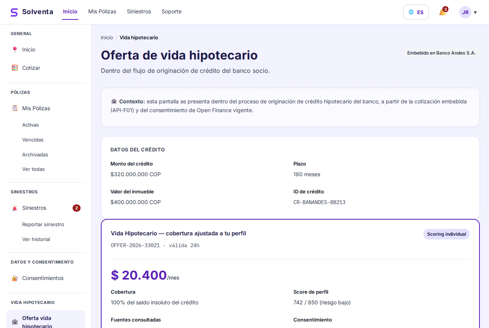

Si solicitas un crédito hipotecario con un banco aliado, verás esta oferta dentro del proceso del banco. Con consentimiento vigente el precio se ajusta a tu perfil; sin él, se muestra la tarifa estándar y un enlace para otorgarlo. **Ver condiciones completas** detalla beneficiario, vigencia y exclusiones. **Suscribir en un clic** te lleva a la compra (sección 5).

## 11. Perfil, configuración y ayuda

- **Mi perfil:** actualiza tus datos y pulsa **Guardar cambios**. Si el correo no es válido, se marca el campo y se explica el error.
- **Configuración:** activa o desactiva notificaciones por correo, push y recordatorios de vencimiento; cambia el idioma (Español / English).
- **Ayuda:** preguntas frecuentes con buscador, chat en vivo, línea 01 8000 123 456 y soporte@solventa.co.

---

# Web · equipos internos

## 12. Tablero operacional

Para el equipo de **Operaciones**. Inicia sesión con **Ingresar como → Operaciones**.

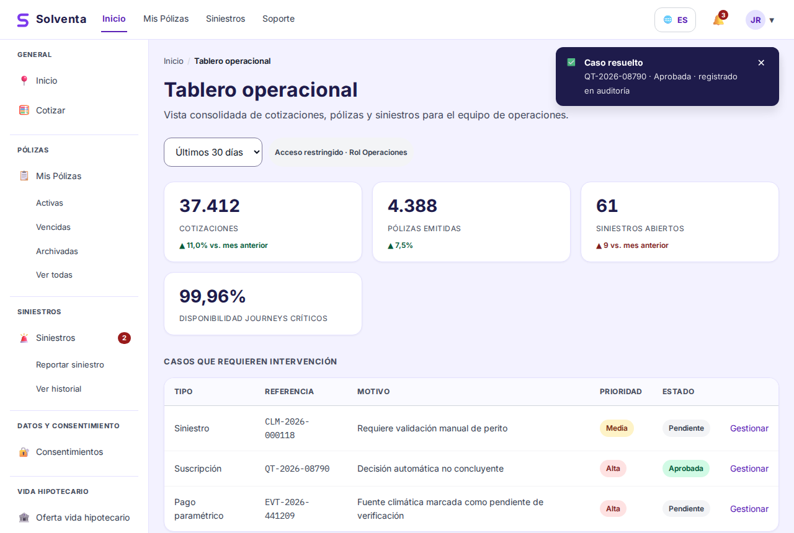

1. Elige el periodo (**Hoy**, **Últimos 7 días**, **Últimos 30 días**) para ver cotizaciones, pólizas emitidas, siniestros abiertos y disponibilidad.
2. En **Casos que requieren intervención**, pulsa **Gestionar**:
   - *Siniestro:* asignar perito o aprobar el pago.
   - *Suscripción no concluyente:* rechazar o aprobar con recargo.
   - *Pago paramétrico con fuente pendiente:* retener o verificar y liberar los pagos.
3. Escribe una nota para la auditoría y elige la acción. El caso queda con su nuevo estado.

Si entras con una sesión de cliente, verás el aviso *No tienes permisos para ver esta sección*.

## 13. Portal de socios de distribución

Para bancos y comercios aliados que venden seguros de Solventa. Inicia sesión con **Ingresar como → Socio de distribución**.

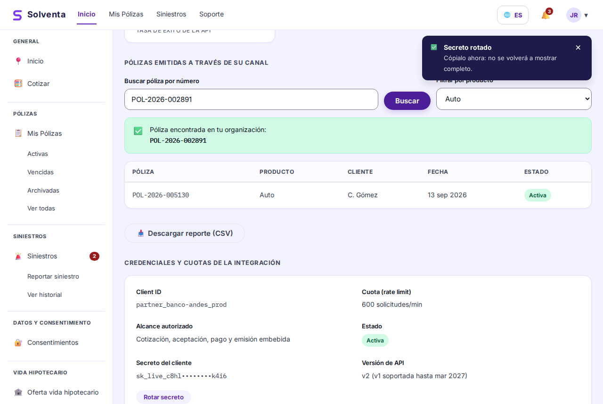

- **Indicadores** de tu canal: cotizaciones vía API, pólizas emitidas, prima colocada y tasa de éxito.
- **Buscar póliza por número** y **Filtrar por producto.** Solo verás pólizas de tu organización: si buscas una de otro canal, aparece *403 · Acceso denegado*.
- **Descargar reporte (CSV)** del periodo.
- **Credenciales:** Client ID, cuota, alcance, versión de API y **Rotar secreto** (el secreto anterior funciona 24 horas más para que actualices tus integraciones).

---

# App móvil

## 14. Crear tu cuenta

En la pantalla de ingreso pulsa **Crear cuenta**.

| 1. Tus datos | 2–3. Selfie y verificación |
|---|---|
| 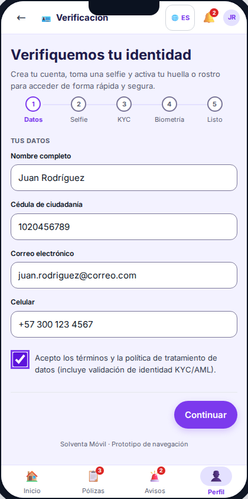 | 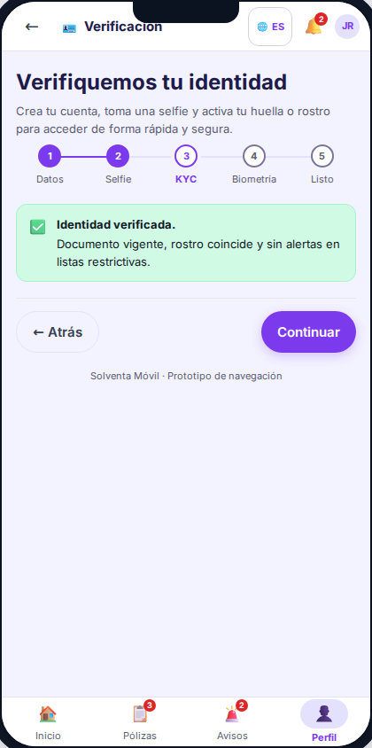 |

La cuenta que creas aquí es la misma con la que entras a la web (sección 1).

1. **Tus datos:** nombre completo, correo y celular (10 dígitos, empieza por 3).
2. **Tu documento:** tipo y número de documento, sin puntos ni espacios.
3. **Tu contraseña:** mínimo 8 caracteres, con letras y números, y su confirmación. Acepta los
   términos y la política de tratamiento de datos y pulsa **Crear cuenta**.
4. **Verifica tu correo:** escribe el código de 6 dígitos que te enviamos. Vence a los 10 minutos y
   tiene 3 intentos; si se agotan o vence, pulsa **Pedir un código nuevo** (tu cuenta sigue activa).
5. **Identidad:** validamos tu identidad en unos segundos; puedes seguir mientras tanto y te
   avisamos el resultado.
6. **Huella o rostro:** si tu celular los tiene, te ofrecemos **Activar** el ingreso con ellos.
   Nunca salen del teléfono: Solventa no los recibe ni los guarda.

Tu contraseña se guarda cifrada de forma irreversible: nadie en Solventa puede leerla.

## 15. Ingresar a la app

| Correo y contraseña | Con huella |
|---|---|
| 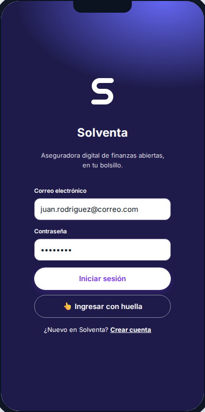 | 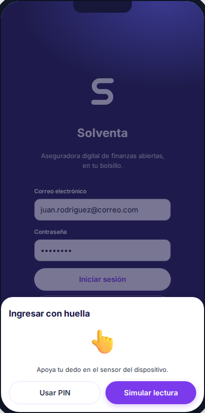 |

Escribe tu correo y contraseña y pulsa **Iniciar sesión**, o pulsa **Ingresar con huella o
rostro**. Si el sensor falla, siempre puedes **Usar contraseña**.

**No tienes que volver a entrar a cada rato.** La app renueva tu sesión sola mientras la uses. Si no
puede renovarla (por ejemplo, después de muchos días sin abrirla), vuelve a la pantalla de ingreso,
con huella si la tienes activa.

Si el correo o la contraseña no son correctos, verás un mensaje que no dice cuál de los dos falló.

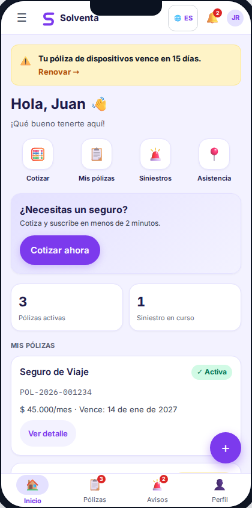

## 16. Consentimiento de datos financieros en la app

Es **el mismo consentimiento de la web** (sección 3): lo que autorizas o revocas en un canal ya está
en el otro. Ábrelo desde **Perfil → Consentimientos Open Finance**.

Cada finalidad (cotización, suscripción y prevención de fraude) muestra su estado: *Vigente*,
*Revocado*, *Vencido* o *Sin consentimiento*, con sus fechas. Si uno vence en 30 días o menos, lo
verás marcado como *Próximo a vencer*.

- **Autorizar:** elige las entidades de las que podemos consultar tus datos (ninguna viene marcada),
  revisa qué datos se consultan y por cuánto tiempo, acepta la versión vigente del texto legal y
  confirma.
- **Revocar:** pulsa **Revocar** y confirma. Desde ese momento, **tu siguiente cotización, en la web
  o en la app, usa la tarifa estándar**, sin descuento por tu perfil financiero.
- **Renovar:** en uno próximo a vencer, pulsa **Renovar** y confirma la nueva fecha; no repites el
  flujo completo.

Si cambiaste algo desde la web con la app abierta, pulsa **Actualizar lista** para ver el estado
actual.

## 17. Cotizar y comprar desde el celular

1. Toca **Cotizar** en el inicio.
2. Elige Dispositivos, Viaje u Hogar.
3. Revisa tus datos y decide si usar **Open Finance** para un precio personalizado.
4. Revisa la oferta (precio, coberturas, **¿Por qué este precio?**).
5. En **Pago** pulsa **Pagar y emitir póliza**.

| Oferta | Póliza emitida |
|---|---|
| 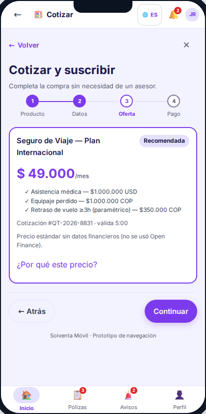 | 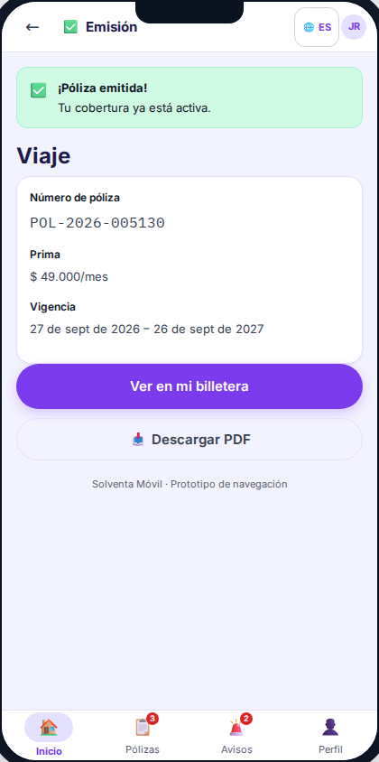 |

La póliza queda de inmediato en tu **billetera**.

## 18. Billetera de pólizas y modo sin conexión

Toca **Pólizas** en la barra inferior. Cada póliza tiene su **credencial digital** con número y vigencia, útil para mostrarla en un taller o una clínica.

| Billetera sin conexión | Credencial sin conexión |
|---|---|
| 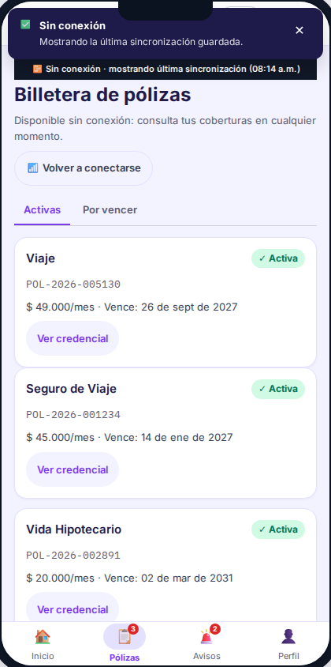 | 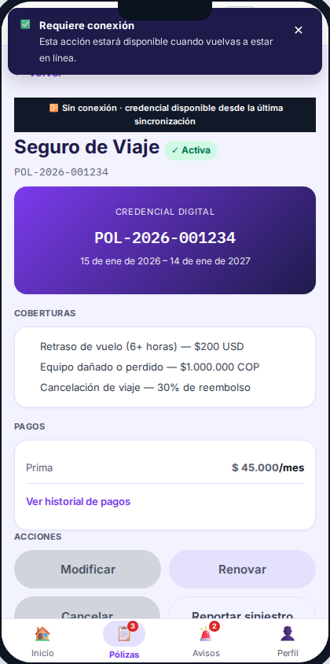 |

**Sin internet** puedes seguir viendo tus pólizas y coberturas desde la última sincronización (lo indica la franja oscura superior). Las acciones que necesitan conexión (modificar, renovar, cancelar) aparecen en gris y, si las tocas, te lo explicamos. En la demo usa **📴 Simular modo sin conexión** y **📶 Volver a conectarse**.

## 19. Siniestros desde el celular

| Reportar con fotos | Mis siniestros | Pago automático |
|---|---|---|
| 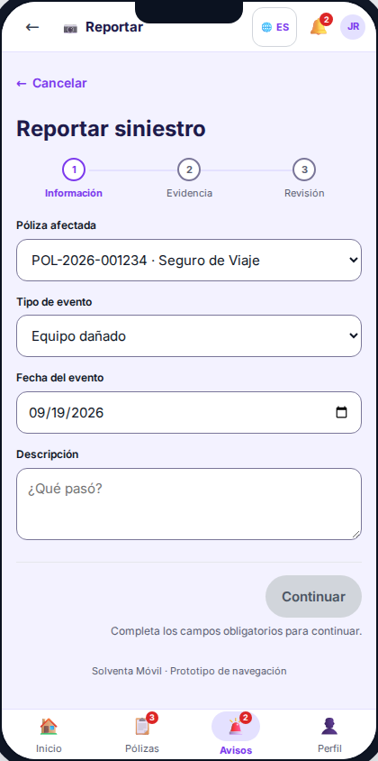 | 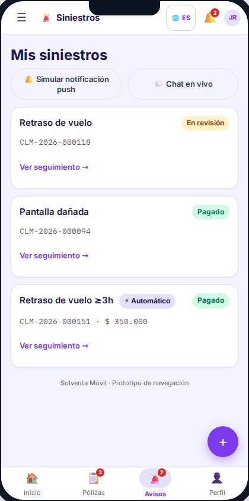 | 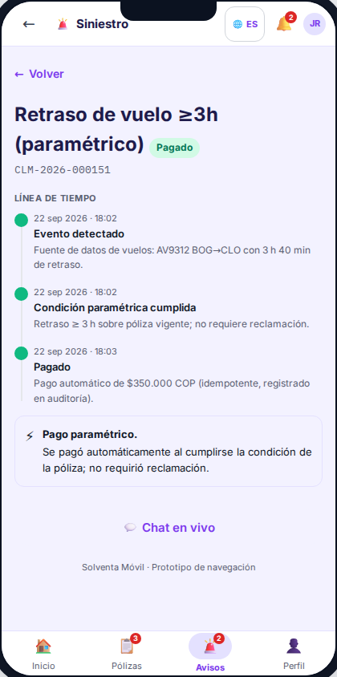 |

Reporta en tres pasos (**Información**, **Evidencia** con la cámara o archivos, **Revisión**), pulsa **Enviar reporte** y sigue el estado en **Mis siniestros**. Los pagos automáticos muestran el evento que los activó.

Las reglas son las mismas de la web (sección 8): la referencia es la misma en los dos canales y, si
pulsas dos veces o se cae la conexión, no queda un reporte repetido.

### Adjuntar evidencia desde el celular

- **Con la cámara:** la foto queda con la fecha y la hora y, si permites la ubicación, con el lugar
  del evento.
- **Sin permiso de cámara o de ubicación:** te explicamos para qué lo usamos y puedes elegir fotos de
  la galería o escribir el lugar. El reporte nunca queda bloqueado.
- **Archivos grandes:** una foto o un video de más de 10 MB se comprime antes de enviarlo. Si aun así
  no cabe, te lo decimos y puedes quitarlo.
- **Después del reporte:** agrega evidencia desde el siniestro. La que adjuntes en la app se ve en
  la web, y al revés.

## 20. Asistencia en sitio

| Permiso de ubicación | Asistencia en camino |
|---|---|
| 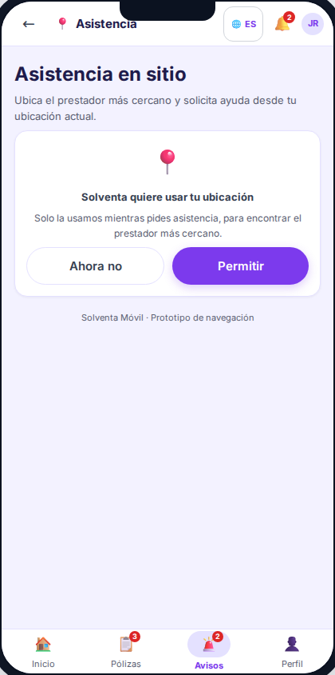 | 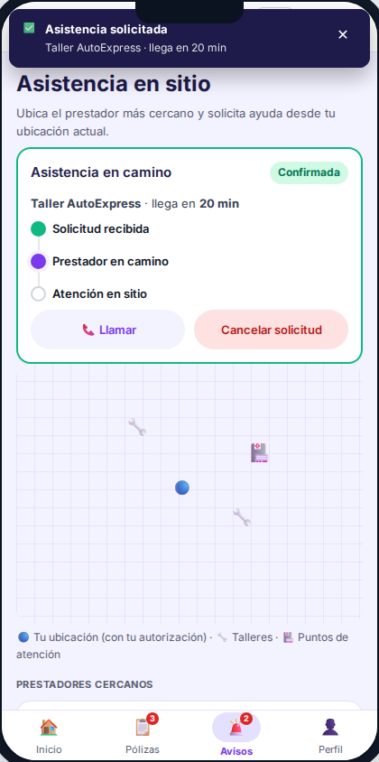 |

1. Abre **Asistencia** desde el inicio.
2. Pulsa **Permitir** para usar tu ubicación. Si prefieres no compartirla, toca **Ahora no** y escribe tu dirección.
3. Elige un prestador cercano, pulsa **Solicitar asistencia**, selecciona la póliza y qué necesitas, y confirma.
4. Sigue la llegada en la tarjeta **Asistencia en camino**. Puedes **Llamar** al prestador o **Cancelar solicitud**.

## 21. Escanear documentos

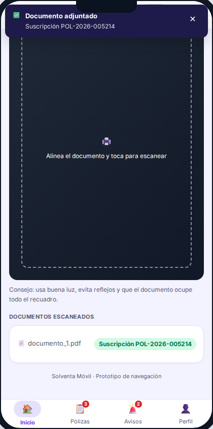

1. Abre **Escanear documento** desde el menú ☰.
2. Alinea el documento dentro del recuadro (buena luz, sin reflejos) y toca para escanear.
3. Elige a qué trámite lo asocias y pulsa **Adjuntar documento**. Si no quedó bien, pulsa **Repetir**.

Tus documentos quedan en **Documentos escaneados**.

## 22. Notificaciones

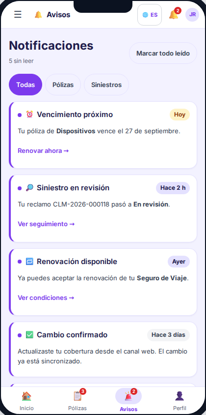

Toca **Avisos** en la barra inferior. Las notificaciones sin leer tienen un punto y un borde de color. Filtra por **Pólizas** o **Siniestros**, toca una para marcarla como leída o usa **Marcar todo leído**. Cada aviso lleva a su acción: por ejemplo, **Renovar ahora** abre la renovación de esa póliza. Ajusta qué avisos recibes en **⚙️ Preferencias de notificación**.

---

## Mensajes que puedes ver y qué hacer

| Mensaje | Qué significa | Qué hacer |
|---|---|---|
| *El correo o la contraseña no son correctos.* | No pudimos iniciar sesión con esos datos. Por seguridad no decimos cuál falló. | Revisa los dos e intenta de nuevo. |
| *Tu sesión venció. Inicia sesión de nuevo para continuar.* | Pasó una hora desde que entraste a la web. | Inicia sesión; vuelves a la página donde estabas. |
| *Código incorrecto. Intentos restantes: …* | El código de verificación del correo no coincide. | Revisa el correo y escríbelo de nuevo. |
| *Usaste los 3 intentos y este código se bloqueó.* | Se agotaron los intentos de ese código. Tu cuenta sigue activa. | Pulsa **Pedir un código nuevo**. |
| *Ya hay una cuenta con este correo.* | Ese correo ya está registrado. | Inicia sesión con él, en la web o en la app. |
| *Completa los campos obligatorios para continuar.* | Falta un dato en el paso actual. | Llena los campos vacíos; el botón **Continuar** se habilita solo. |
| *No tienes un consentimiento vigente.* | No autorizaste el uso de tus datos financieros. | Cotiza con precio estándar u otorga el consentimiento desde el enlace. |
| *Tu entidad financiera no respondió a tiempo, así que usamos tu perfil financiero guardado.* | Tu banco tardó en responder. | Nada: el precio es igual de válido y la cotización sigue normalmente. |
| *La cotización venció.* | Pasaron los 5 minutos de garantía del precio. | Pulsa **Recotizar**. |
| *Debes tener al menos 18 años para cotizar.* | La edad está fuera del rango asegurable (18 a 100 años). | Revisa la fecha de nacimiento. |
| *No pudimos calcular tu oferta.* | Hubo un problema al cotizar. | Pulsa **Ver mi oferta** de nuevo en unos segundos. |
| *En revisión asistida* | Tu solicitud necesita revisión de un analista. | Espera la notificación (máximo 4 horas). |
| *Pago rechazado por el banco emisor.* | El banco no aprobó el cobro. No se cobró nada. | Verifica los datos o usa otro medio e intenta de nuevo. |
| *Tu banco aún no confirma el pago.* | El pago está pendiente, normalmente con PSE. | No pagues de nuevo; pulsa **Consultar estado del pago** en unos minutos. |
| *Tu pago ya está en curso.* / *Este pago ya se había procesado.* | Reintentaste un pago que ya estaba en marcha o hecho. No hubo un segundo cobro. | Nada: espera el resultado o revisa la referencia del pago. |
| *No pudimos confirmar tu pago.* | Se perdió la conexión mientras pagabas. | Pulsa **Consultar estado del pago**; reintentar es seguro. |
| *El texto legal se actualizó.* (app) | Cambió la versión del texto de autorización mientras lo leías. | Revisa la versión vigente y acéptala de nuevo. |
| *Este consentimiento ya no está vigente. La lista se actualizó…* (app) | Lo revocaste o venció, quizá desde la web. | Revisa el estado actual; si lo necesitas, autorízalo de nuevo. |
| *La fecha del evento no puede ser posterior a hoy.* | La fecha del siniestro está en el futuro. | Corrige la fecha. |
| *Este evento no está cubierto: ocurrió fuera de la vigencia de la póliza.* | El evento es posterior al fin de la póliza. No se registró nada. | Revisa la fecha o elige otra póliza. |
| *No pudimos confirmar el envío de tu reporte.* | Se perdió la conexión al enviar. | Intenta de nuevo: si ya había llegado, verás la misma referencia. |
| *…: este formato no se admite.* / *…: pesa … y el máximo es 10 MB.* | La evidencia no es JPEG, PNG, HEIC, MP4 o PDF, o pesa más de 10 MB. | Usa otro archivo o reduce su tamaño. |
| *…: no se adjuntó porque el almacén de evidencias no respondió.* | No pudimos guardar el archivo en ese momento. El reporte sí quedó. | Agrégala después desde **Evidencias**. |
| *Requiere conexión* | Estás sin internet. | Vuelve a intentarlo cuando tengas conexión. |
| *403 · Acceso denegado* (socios) | La póliza no pertenece a tu organización. | Verifica el número; solo ves pólizas de tu canal. |
| *No tienes permisos para ver esta sección.* | Tu usuario no tiene ese rol. | Ingresa con el usuario correspondiente. |

## Accesibilidad e idioma

- **Idioma:** botón 🌐 **ES/EN** en la barra superior o **Configuración → Idioma**. Montos y fechas se ajustan al idioma.
- **Teclado:** todo se puede usar con Tab, Enter, Espacio y Escape. Al inicio de cada pantalla, **Saltar al contenido principal** evita recorrer el menú.
- **Lectores de pantalla:** los avisos, los pasos de los asistentes y los resultados de cada acción se anuncian automáticamente.
- **Tamaño táctil:** en el celular todos los botones miden al menos 44×44 px.
